# agri-origin · 基于 FISCO-BCOS 联盟链的农产品质量安全溯源系统

> 一批菜从 **建档 → 村级核验 → 农事 → 采收 → 质检 → 物流 → 销售**，每一步由谁录入、谁审核、什么时候上链，
> 在系统里都能查到、能验、能被追责。消费者扫码看到的是链上哈希与链下数据比对后的结果，而不是一张截图。


**线上地址**：<https://8-130-105-150.sslip.io/> · 演示账号见 [§15.1](#151-演示账号)，密码统一 `123456`

**技术关键词**：Spring Boot · MyBatis-Plus · JWT + RBAC · uni-app 三端 · MySQL 8 · FISCO-BCOS 2.9.1 · Solidity 0.6.10 · SHA-256 存证

---

## 目录

| 章节 | 内容 |
| --- | --- |
| [一](#一这是个什么系统) | 这是个什么系统 |
| [二](#二界面预览) | 界面预览（含一条批次的完整旅程） |
| [三](#三项目背景与要解决的问题) | 项目背景与要解决的问题 |
| [四](#四系统架构) | 系统架构：分层架构图 · 功能模块图 · 数据流向 |
| [五](#五技术栈) | 技术栈 |
| [六](#六角色权限与数据范围) | 角色与权限：组织图 · 用例图 · 权限矩阵 |
| [七](#七业务流程与状态机) | 业务流程：主流程 · 异常熔断 · 审核闭环 · 状态机 |
| [八](#八提交审核闭环) | 提交—审核闭环（本项目重点） |
| [九](#九链上存证设计) | 链上存证设计 |
| [十](#十溯源可信度评分-agritrust5d) | 溯源可信度评分 AgriTrust-5D |
| [十一](#十一数据模型) | 数据模型：ER 图 · 19 张表 · 字段设计 |
| [十二](#十二接口概览) | 接口概览 |
| [十三](#十三部署与运维) | 部署与运维 |
| [十四](#十四测试与验收) | 测试与验收 |
| [十五](#十五快速启动与演示) | 快速启动与演示 |
| [十六](#十六仓库结构) | 仓库结构 |
| [十七](#十七文档索引) | 文档索引 |
| [十八](#十八开发分工与许可) | 开发分工与许可 |
| [十九](#十九已知限制与后续计划) | 已知限制与后续计划 |

---

## 一、这是个什么系统

一句话：**给农产品建一份"谁也改不了、谁做的谁负责"的电子档案**。

一份档案（系统里叫**批次**）从生产主体建档开始，依次经过村级核验、农事记录、采收登记、质量检测、物流运输、终端销售七个环节。
每个环节的提交人、提交时间、审核人、审核意见，以及业务数据的 SHA-256 摘要，都会写进联盟链；链下 MySQL 只负责"查得快"，
链上只存"改不了"的摘要。消费者扫码时，服务端会把链下数据重新算一遍哈希，和链上的比对——对不上就明确告诉你对不上，绝不假报"存证成功"。

系统要同时服务八种角色，所以设计上有三个绕不开的点：

1. **数据范围**：农户只看自己的批次，村管只看本村，监管看全量。范围不是前端过滤，是 SQL 层直接收窄，越权返回 403。
2. **流程顺序**：没通过村级核验的批次，农户提交农事会被直接拒绝；质检不合格的批次，销售登记会被熔断拦截。顺序在服务层强制，不靠界面约束。
3. **提交之后呢**：这一条最容易做漏——农户点了提交、页面提示"成功"，然后就没有然后了。本系统把"提交—审核"做成闭环：
   提交方立刻看到"等待谁审核"，审核方在"审核待办"里看到轮到自己处理的事，批次详情能看到七个环节逐级的进度。

### 1.1 五个能拿得出手的设计

| # | 设计 | 为什么重要 |
| --- | --- | --- |
| 1 | **一环节一存证 + 链下重算比对** | 不是"有区块链"四个字，而是每条记录都能拿链上哈希跟本地重算结果对一遍，对不上就报错 |
| 2 | **提交—审核闭环** | 提交方知道在等谁、审核方知道有几件事、进度逐级可见，流程不会停在"提交成功"四个字上 |
| 3 | **数据范围在 SQL 层收窄** | 农户/村管/监管看到的数据天然不同，越权返回 403，而不是前端把按钮藏起来 |
| 4 | **流程顺序与熔断由服务层强制** | 没核验不能录农事、不合格不能卖，绕过界面直接调接口同样会被拦 |
| 5 | **AgriTrust-5D 可信度评分** | 把"上没上链"的二值判断变成 0–100 分 + 扣分理由，消费者看得懂，答辩也讲得清 |

---

## 二、界面预览

以下截图全部来自**线上真实运行的这一版**（`https://8-130-105-150.sslip.io`，真实上链，非演示模式），
数据是同一条批次 `AG20261109011`（小白菜 · 上海青）从建档走到售出的真实记录。

### 2.1 一条批次的完整旅程（同一页面的四个时刻）

批次详情页最上面是**溯源可信度评分**，下面是**审核进度**：百分比、进度条、七个环节的横向节点条，
再往下逐个环节列出"谁提交、什么时候提的、谁审的、什么时候审的、审核意见"。四个时刻对照着看，就是一个流程的推进过程：

| 时刻 | 进度 | 卡在哪 |
| --- | --- | --- |
| ① 生产主体刚建档 | 29% | 等待村级核验 |
| ② 村管核验通过、农户提交农事 | 43% | 等待村管审核农事 |
| ③ 农事/采收通过、检测机构上传报告 | 71% | 等待监管复核质检 |
| ④ 物流、销售登记并复核完成 | 100% | 全流程完成，可扫码溯源 |

**① 建档完成，等村管核验**（29%，2/7 环节已推进）

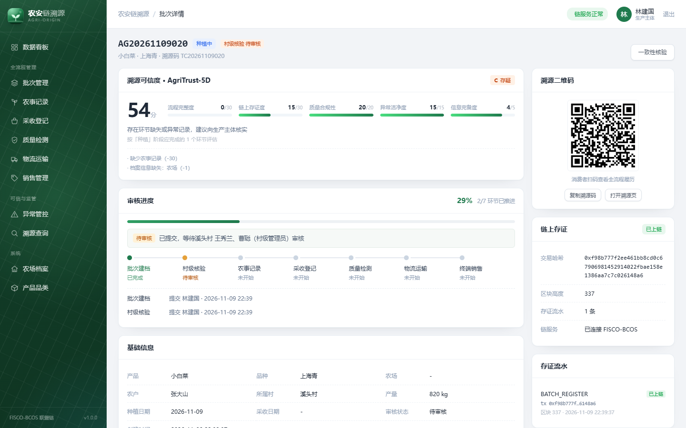

**② 农事已提交，等村管审核**（进度条前进，农事环节变橙）

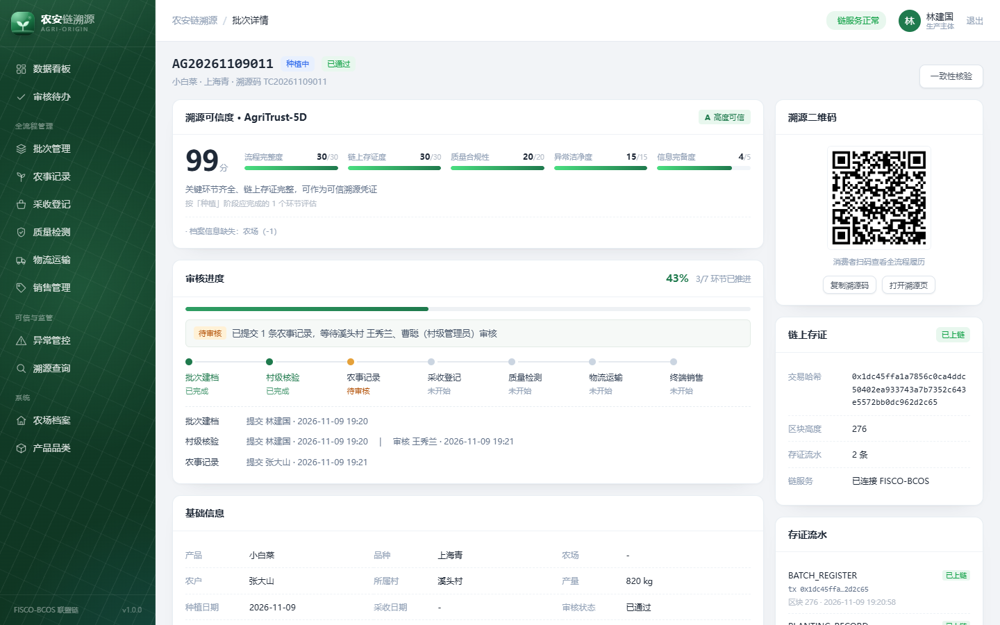

**③ 质检报告已上传，等监管复核**

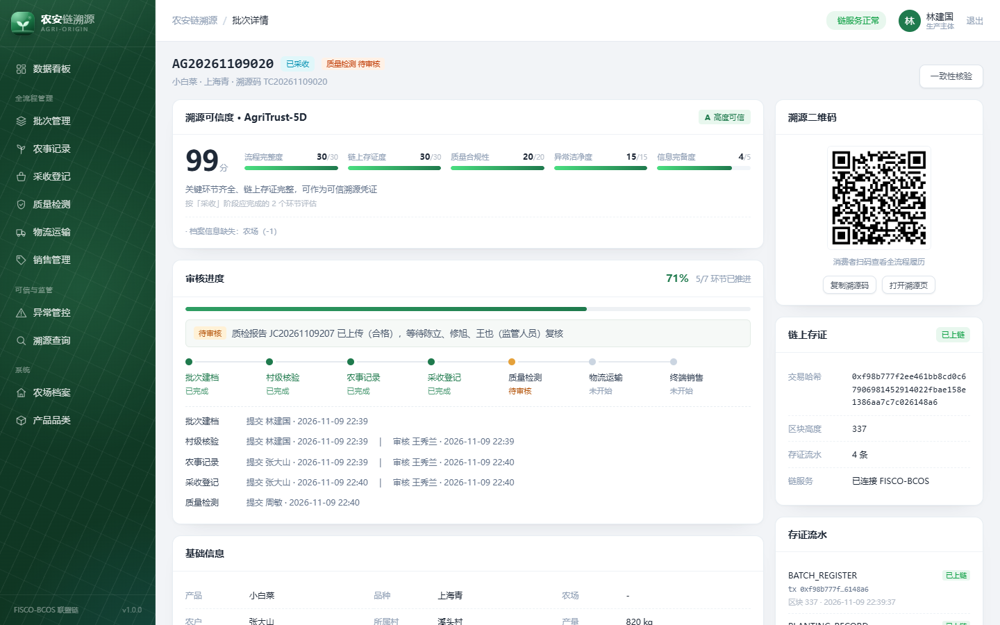

**④ 全流程完成，可信度 99 分、7/7 环节已推进**


> 每个环节的"已提交 / 待审核 / 已驳回 / 未开始"用颜色区分；被驳回时会显示驳回原因，提交方修正后可重新提交。
> 进度条按"已推进环节"计算（已提交或已通过），所以不会出现"货都卖了，进度还停在 43%"这种别扭的显示。

批次详情往下还有基础信息、存证流水、全流程时间轴，滑动一屏能看到：

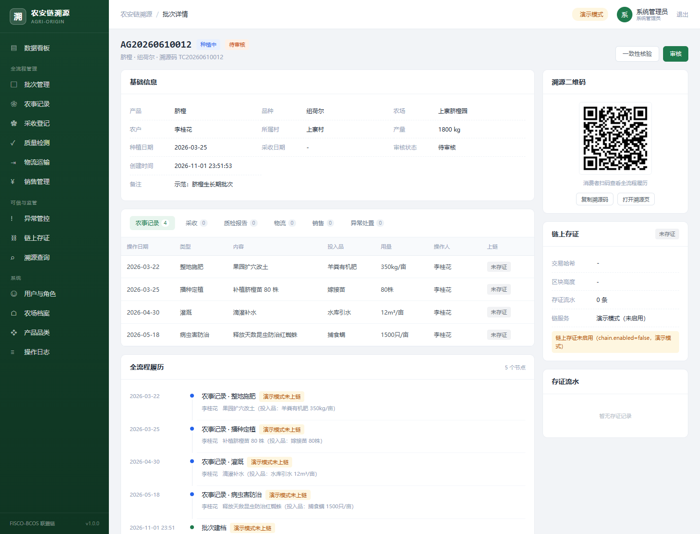

### 2.2 提交—审核闭环：三个界面互相咬合

这是本系统与"能录入、能查询"的普通溯源系统最大的区别。三张页面说的是同一件事：

**(1) 提交方：提交完立刻知道在等谁**（移动端实测截图，弹窗由 `/workflow/notice` 实时返回）

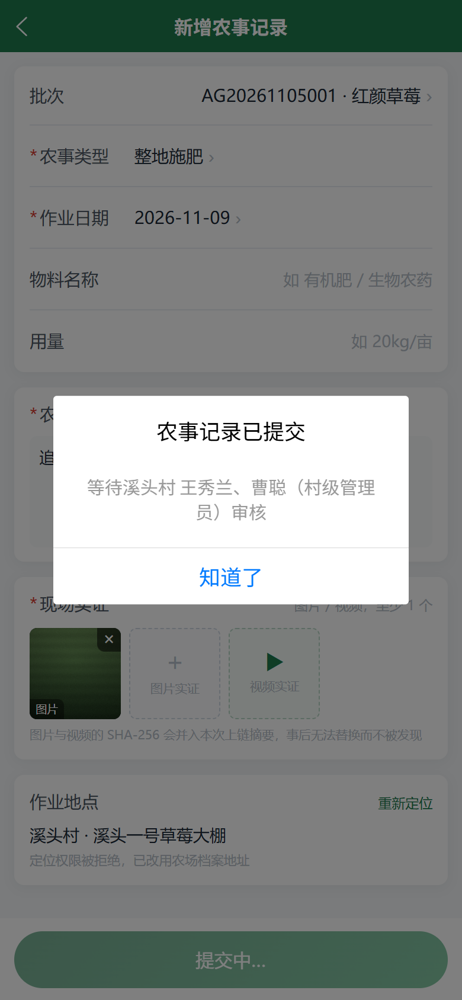

**(2) 审核方：登录就看到"有几项在等我"**（村管工作台，黄色横幅直接进待办）

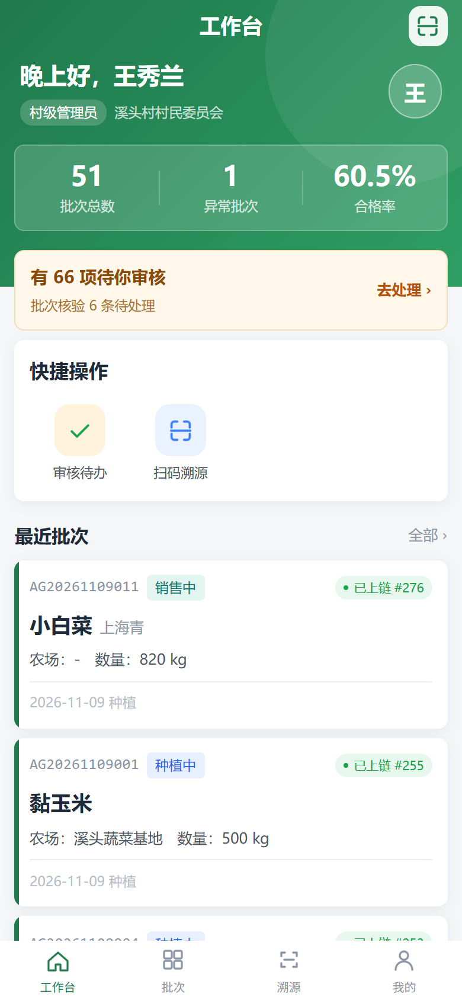

**(3) 审核方：待办列表按业务分组，可直接通过/驳回**

村管视角——本村批次核验、本村农事、本村采收（含尚未建档的"手写作物"）：

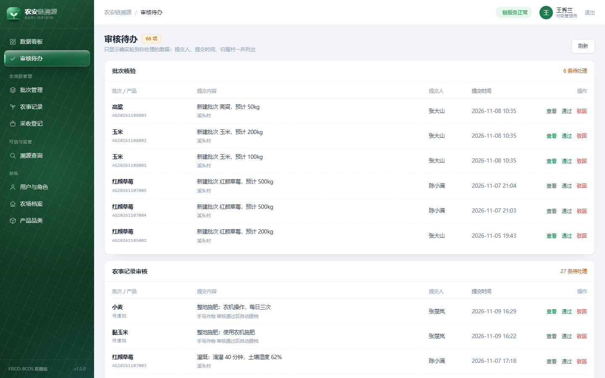

监管视角——质检、物流、销售三类复核（村级核验不属于监管的日常职责，不推给他，否则真正等他复核的事会被埋掉）：

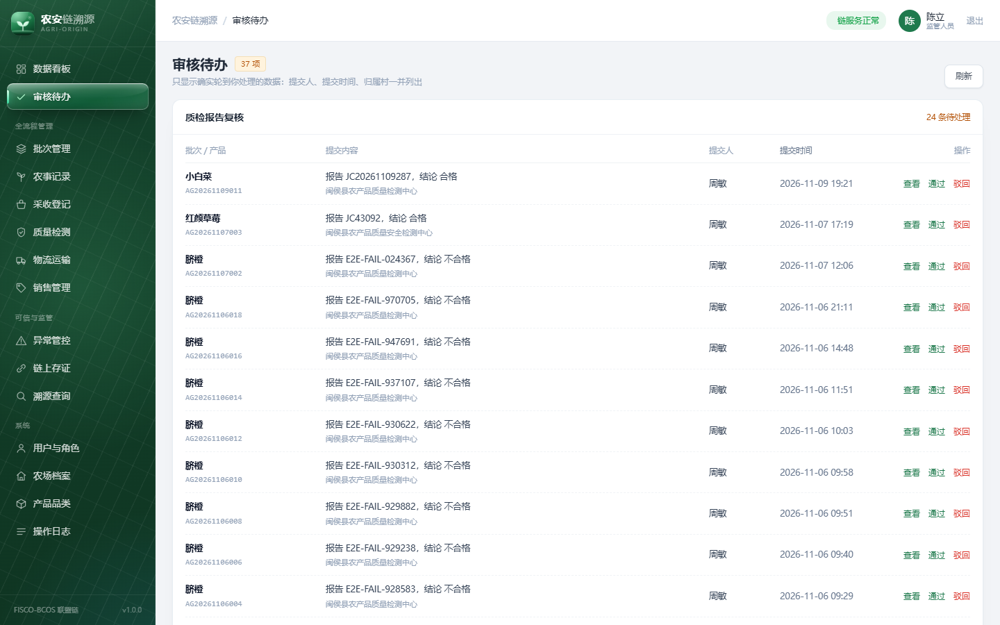

移动端同一份数据，卡片式排布，单手可审：

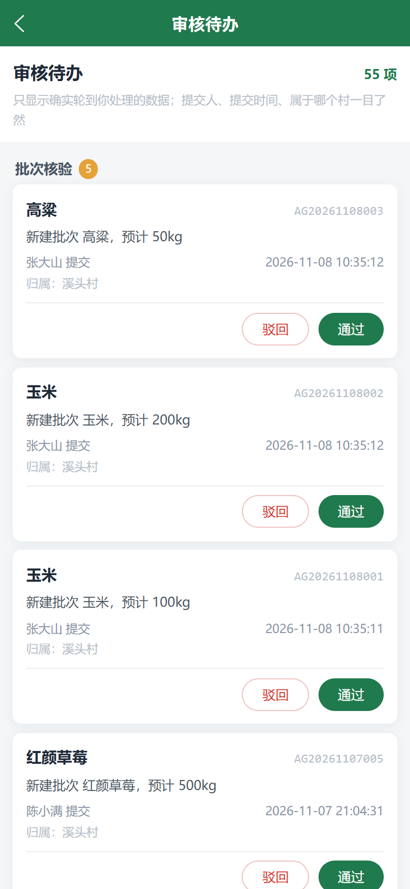

三处提示的口径完全一致：**"已提交，等待<村名> <审核人姓名>（角色）审核"**，人走了、账号停用了会立刻从名单里消失，
一个村配了很多村管时只列前三个加"等 N 人"，不会把提示条撑爆。

### 2.3 PC 管理端（宽屏自适应）

**登录**：左侧品牌叙事，右侧账号登录，演示账号一键填入。


**数据看板**：批次总量、异常批次、质检合格率、上链成功率，状态分布、近 7 日建档趋势、村级分布、链上存证概览。


**批次管理**：按批次号/产品/溯源码搜索，状态与存证状态在表格里直接可见，行内可"详情 / 核验"。


**批次详情**：可信度评分、审核进度、溯源二维码、链上存证、全流程时间轴（见 [§2.1](#21-一条批次的完整旅程同一页面的四个时刻)）。


**七类业务页面**

| 农事记录 | 采收登记 | 质量检测 |
| --- | --- | --- |
|  |  |  |
| **物流运输** | **销售管理** | **异常管控** |
|  |  |  |

**链上存证**：链服务状态、当前区块高度、合约地址、上链成功/失败/跳过计数、逐笔流水（交易哈希、区块号、Gas、状态）。


**系统管理**

| 用户与角色 | 农场档案 | 产品品类 | 操作日志 |
| --- | --- | --- | --- |
|  |  |  |  |

**菜单按权限实时裁剪**：同一套代码，管理员 15 项、农户 6 项、物流企业 5 项，没有权限的分组连标题一起不渲染。

**表格的统一约定**：主操作留在行内，「重置密码 / 启停 / 删除」这类次要操作收进「更多」下拉——
一行铺六个文字按钮会把列撑爆，最右边的"删除"直接被裁掉看不见。
说明性字段（异常描述、处置措施、操作内容、备注）按行折行完整展示，宁可行高跟着内容走，
也不做单行截断：截成"质检报告 E2E-FAIL…"等于没说，不合格原因整个被吞了。

| 系统管理员 | 农户 | 物流企业 |
| --- | --- | --- |
|  |  |  |

### 2.4 移动端（同一份代码，390×844）

农户在田里用手机录入，是这套系统最主要的使用场景，所以移动端不是"PC 页面缩小"，而是独立的一套页面与交互。

| 登录 | 工作台（农户） | 我的批次 |
| --- | --- | --- |
|  |  |  |
| **批次详情（含进度）** | **农事记录（可见审核状态）** | **链上存证** |
|  | 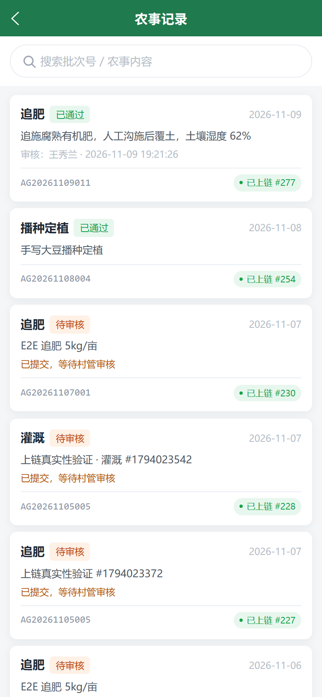 | 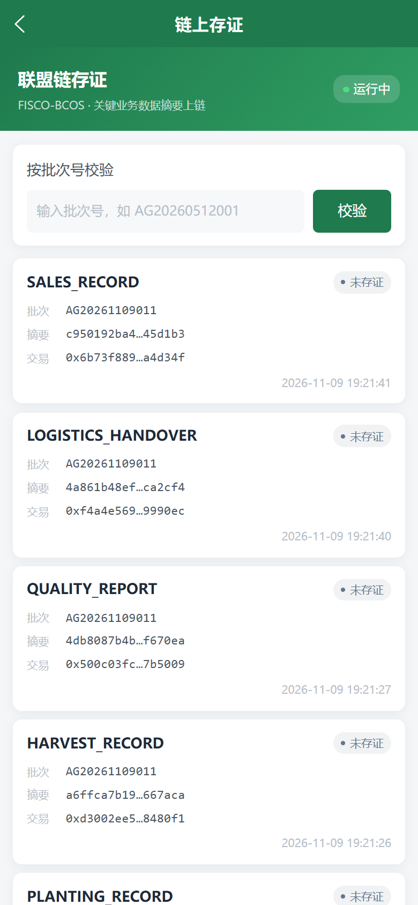 |

移动端批次详情把七个环节竖排，逐条写明"提交 张大山 · 19:11 / 审核 王秀兰 · 19:12"，不用点开二级页就能看完整个履历：


**录入即留痕**：农事与采收都必须上传"现场实证"（图片或视频至少 1 条），文件 SHA-256 与业务摘要一并上链；
作业地点打开表单自动定位（GPS → 农场档案兜底），采收天气按当日实况带出，两者都需要用户确认而不是默认填充。

### 2.5 消费者溯源（免登录）

扫码进的就是这页：产品档案、可信度评分（含五个维度的得分与扣分说明）、全流程时间轴、链上存证与一致性校验。

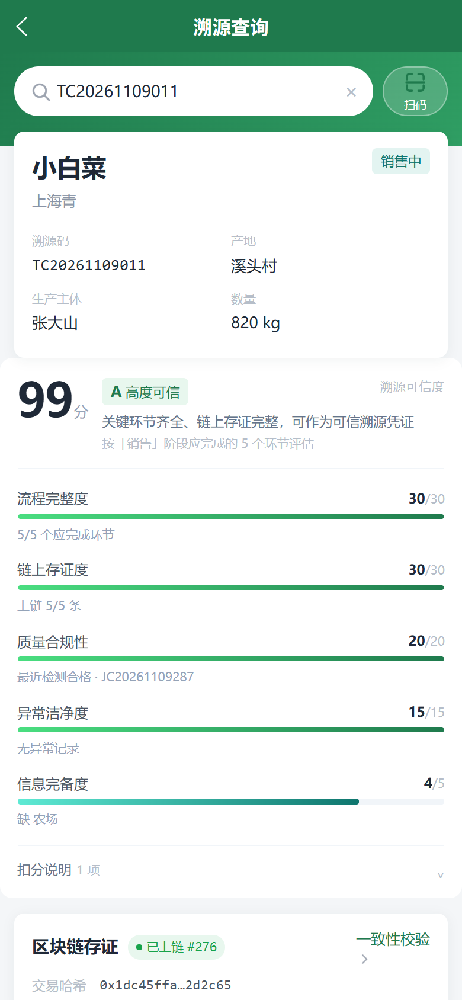

PC 端同一份数据，宽屏排成左右两栏：


溯源查询入口页，支持输溯源码/批次号，也给几个真实样本码一键试：


### 2.6 自助注册（三端同一入口）

登录页底部「立即注册」→ 注册页。农户、生产主体、检测机构、物流企业、销售商五类身份可自助注册，注册成功直接签发 JWT 进系统；
村管、监管、管理员三种治理身份不开放自助注册（能改别人数据的账号只走线下实名开通），点它们会提示原因而不是静默无反应。

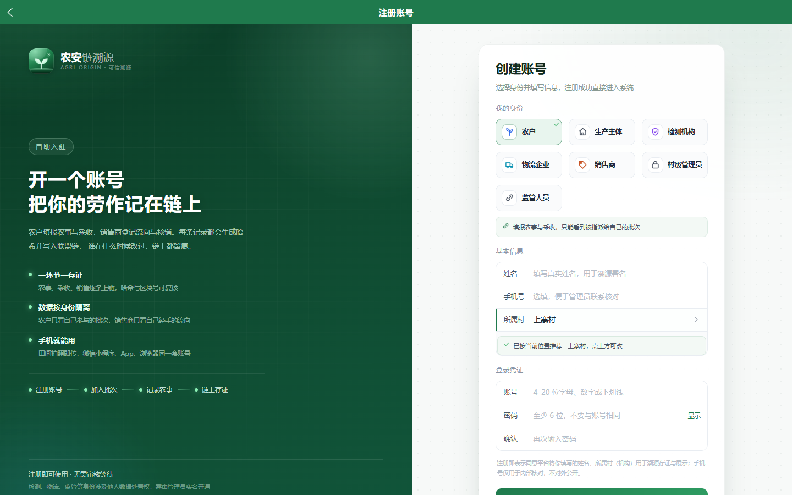

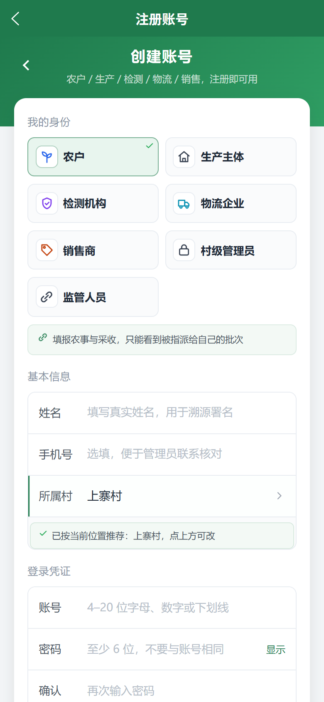

五个自助注册的账号走完的一条真实批次（`AG20261107003`），消费者扫码看到的样子：

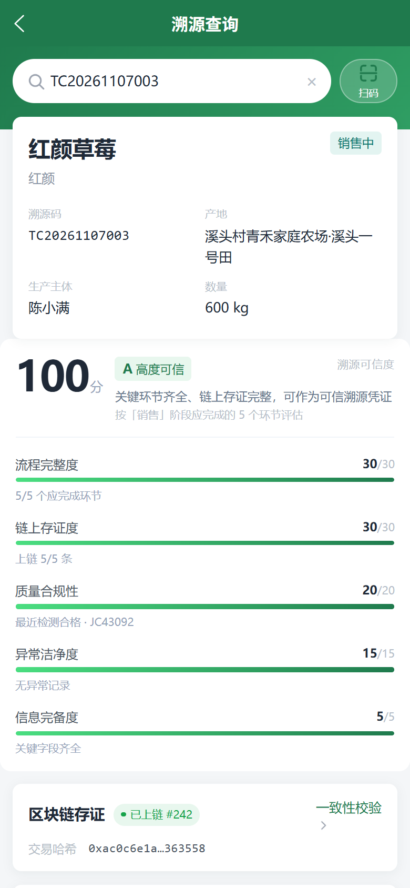

---

## 三、项目背景与要解决的问题

农产品从田间到餐桌链路长、参与主体多。传统中心化溯源系统的通病是：**平台自己既当运动员又当裁判**，
数据存在平台库里，改一条记录不留痕，出了事各主体互相不认账。本项目用联盟链把"记账权"分散到各参与方：

| 问题 | 传统做法 | 本项目的做法 |
| --- | --- | --- |
| 数据可被单方篡改 | 平台数据库，改了就改了 | 业务明细在 MySQL，摘要上链；改一个字段哈希就变，校验立刻失败 |
| 责任难界定 | 只记录"哪个企业"，不记录"哪个人" | 每条记录带提交人、审核人、时间、设备定位，逐级签字 |
| 跨主体互不信任 | 各自系统，接口对不上 | 同一联盟链、同一合约，检测/物流/销售都由链上事件留痕 |
| 出了问题追不动 | 只能查本环节 | 支持上游来源 + 下游流向双向追溯，异常批次全链熔断 |
| 消费者看不懂 | 一堆专业字段 | 折算成 0–100 可信度评分 + 逐条扣分理由 |

设计上的一条硬规则：**不伪造成功**。链不可用时系统进"演示模式"，页面如实显示"未上链"，
`/chain/verify` 返回失败，绝不在没有交易哈希的情况下显示"存证成功"。

---

## 四、系统架构

系统按 **七层** 组织，自下而上单向依赖：上层只调下层暴露的接口，跨层调用只在两个地方开口——
所有链上操作走 `sdk.BcosClient`，所有文件读写走文件服务。这一节回答三个问题：
**由哪些层组成、每层具体管什么、一个请求怎样走完全程。**

### 4.1 总体分层架构

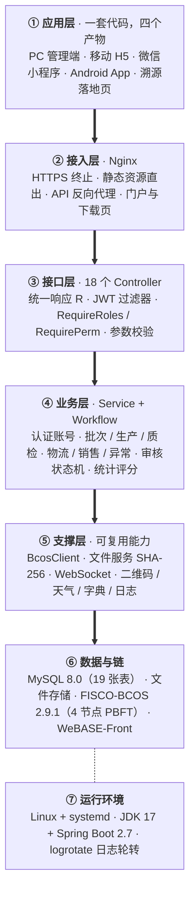

> 图里每一层都能在仓库里找到对应目录：应用层 `frontend/uni-app/src`、接口与业务层 `backend/src/main/java`、
> 数据与链 `sql/` + `ops/`、运行环境 `ops/systemd`。不是示意图，是代码结构本身。

### 4.2 逐层职责与关键实现

| 层 | 组成 | 关键职责 | 代码位置 |
| --- | --- | --- | --- |
| ① 应用层 | uni-app 3.0（Vue 3.4 + Vite 5.2 + Pinia） | 一份 `src/` 出 H5 / 小程序 / App；≥900px 自动切 PC 管理台，窄窗回落移动版；无本地业务库 | `frontend/uni-app/src` |
| ② 接入层 | Nginx 1.18 | TLS 终止、静态资源直出、`/api` 反代、`location = /` 精确匹配门户（只吃根路径，不影响 `/pages/**`） | `ops/nginx/` |
| ③ 接口层 | 18 个 Controller | 入参校验、JWT 解析、`@RequireRoles` + `@RequirePerm` 双注解鉴权、统一 `R<T>` 响应与错误分码 | `backend/.../controller` |
| ④ 业务层 | Service + Workflow | 环节顺序校验、数据范围收窄、审核状态机、摘要组装、异常熔断 | `backend/.../service` |
| ⑤ 支撑层 | BcosClient、文件服务、WebSocket | 链交互唯一出口（健康探测 / 断连重建 / ABI 从 classpath 读）、文件摘要与落盘、批次事件广播 | `backend/.../sdk`、`.../service` |
| ⑥ 数据与链 | MySQL 8.0、文件盘、FISCO-BCOS 2.9.1 | 明细可查、摘要上链、区块浏览器只读（仅监听 127.0.0.1，反代 + Basic 认证） | `sql/`、`ops/chain` |
| ⑦ 运行环境 | Linux + systemd | 4 个链节点 / 后端 / WeBASE 全部单元化，日志轮转，密钥抽到 `backend.env` | `ops/systemd/` |

**三个"唯一出口"是这层的硬约束**（改代码时最容易被打破，所以写进架构）：

1. **链只认一个口**：`sdk.BcosClient`。业务里不允许出现第二处 `Web3j` 调用，否则断连重建、重试、降级演示模式会各写一套。
2. **文件只认一个口**：上传即算 SHA-256，摘要随业务摘要一起上链；文件被撤销后下载返回 403，而不是删库留空。
3. **状态只认一个口**：批次状态由"已审核通过的记录"推导，任何界面都不自己拼状态字符串。

### 4.3 功能模块结构

平台功能按 **8 个模块** 划分，模块之间靠批次号（`batch_no`）串联，不共享内部状态：

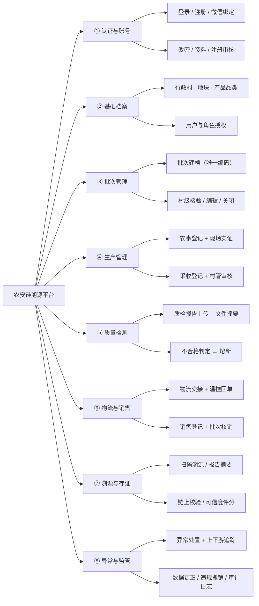

每个模块落到界面与接口上是一一对应的，排查问题可以按这张表定位：

| 模块 | 主要界面 | 后端控制器 | 涉及数据表 |
| --- | --- | --- | --- |
| ① 认证与账号 | `auth/login`、`auth/register`、`auth/password`、`common/settings` | `AuthController`、`SystemController`、`AdminController` | `sys_user`、`sys_role` |
| ② 基础档案 | PC 系统管理（用户与角色 / 农场档案 / 产品品类）、`batch/create` | `SystemController`、`PublicController` | `base_village`、`base_farm`、`base_product`、`sys_dict` |
| ③ 批次管理 | `batch/list`、`batch/create`、`batch/detail`、`tabbar/batch` | `BatchController` | `biz_batch` |
| ④ 生产管理 | `planting/list`、`planting/form`、`harvest/form` | `PlantingController`、`HarvestController` | `biz_planting_record`、`biz_harvest_record` |
| ⑤ 质量检测 | `quality/list`、`quality/form` | `QualityController` | `biz_quality_report` |
| ⑥ 物流与销售 | `logistics/form`、`sales/form` | `LogisticsController`、`SalesController` | `biz_logistics_record`、`biz_sales_record` |
| ⑦ 溯源与存证 | `trace/index`（免登录）、`chain/index`、`tabbar/trace` | `TraceController`、`ChainController` | `chain_record`、`sys_file` |
| ⑧ 异常与监管 | `abnormal/index`、`workflow/todo` | `AbnormalController`、`CorrectionController`、`WorkflowController`、`StatsController` | `biz_abnormal_disposal`、`biz_correction`、`sys_operation_log` |

### 4.4 一条农事记录的数据流向

写路径（提交）：

```
农户 H5 填表 → 上传现场实证（算文件 SHA-256）
   → POST /planting（服务端校验：批次存在、已通过核验、本人有权、当日同类未重复）
   → 组装业务摘要 dataHash（SHA-256）
   → BcosClient 调合约存证 → 返回 txHash / blockNumber
   → 写 biz_planting_record（含 dataHash / audit_status=PENDING）+ chain_record
   → WebSocket 广播事件 → 村管的待办与工作台角标自动刷新
```

读路径（查询 / 溯源）：

```
扫码或列表请求 → 按数据范围收窄 SQL（SELF / VILLAGE / ORG / ALL）
   → 只取 audit_status=APPROVED 的记录（溯源页连未审核的都看不到）
   → 需要证明"没被改过"时：按同一规则重算 dataHash → 调 /chain/verify 比对链上摘要
   → 一致返回 verified=true，不一致如实返回失败，不改写任何本地数据
```

---

## 五、技术栈

| 层次 | 技术选型 | 说明 |
| --- | --- | --- |
| 前端（三端统一） | uni-app 3.0（Vue 3.4 + Vite 5.2 + Pinia 2.1） | 一份 `src/` 出 H5 / 微信小程序 / App 三个产物 |
| 前端（H5 自适应） | 自研 PC shell + 移动 tabbar | ≥768px 进 PC 管理端（16 页），更窄进移动工作台，随窗口缩放实时切换 |
| 后端 | Spring Boot 2.7.18 + MyBatis-Plus 3.5.3 + JWT + Knife4j 4.4 + Hutool 5.8 | 统一响应 `R<T>`、`BizException` 分码 |
| 数据库 | MySQL 8.0（utf8mb4） | 逻辑删除 `deleted`、乐观锁 `version` |
| 区块链 | FISCO-BCOS **2.9.1** + Solidity 0.6.10 + fisco-bcos-java-sdk 2.9.1 | 4 节点 PBFT 单群组，一环节一存证 |
| 链可视化 | WeBASE-Front 1.5.5 | 只监听 127.0.0.1，nginx 反代 + Basic 认证 |
| 实时同步 | Spring WebSocket | 批次核验 / 异常处置 / 上链存证事件广播 |
| 文件存储 | 本地磁盘（可切 OSS/MinIO） | 文件 SHA-256 摘要随业务摘要上链 |
| 部署 | nginx + systemd + logrotate | 4 个链节点 / 后端 / WeBASE 全部单元化 |

### 为什么是"链下明细 + 链上摘要"

全量数据上链在联盟链上跑不动：一次写入要全节点共识，图片和长文本更不可能。所以采用**摘要上链**：

- 链下存明细，按业务字段排序后序列化，算 SHA-256 得 `dataHash`；
- 链上只存 `batchNo + eventType + dataHash + fileHash`；
- 校验时按同样规则重算、比对。**任何字段被改，哈希必然不同**——这就够证明"没被改过"了。

---

## 六、角色、权限与数据范围

### 6.1 角色架构组织图

平台按 **"一个产地侧、一个流通侧、一个治理侧"** 三段划分角色域：产地侧负责"东西是怎么种出来的"，
流通侧负责"东西怎么检、怎么运、怎么卖"，治理侧负责"出了事谁来管"。八种角色挂在三个域下：

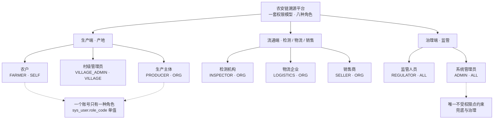

| 角色编码 | 角色 | 所属域 | 核心职责 | 数据范围 | 主用端 |
| --- | --- | --- | --- | --- | --- |
| `FARMER` | 农户 | 生产端 | 农事记录、采收提交、现场拍照 | `SELF` | 移动 H5 |
| `VILLAGE_ADMIN` | 村级管理员 | 生产端 | 辖区农户管理、批次核验、农事/采收审核 | `VILLAGE` | PC / H5 |
| `PRODUCER` | 生产主体 | 生产端 | 地块登记、产品与批次建档、全流程跟踪 | `ORG` | PC |
| `INSPECTOR` | 检测机构 | 流通端 | 质检报告上传、合格/不合格判定 | `ORG` | PC |
| `LOGISTICS` | 物流企业 | 流通端 | 运输交接登记、温控与回单上传 | `ORG` | PC |
| `SELLER` | 销售商 | 流通端 | 销售登记、批次核销 | `ORG` | PC |
| `REGULATOR` | 监管人员 | 治理端 | 全量监管、质检/物流/销售复核、异常处置 | `ALL` | PC |
| `ADMIN` | 系统管理员 | 治理端 | 用户治理、流程兜底、违规撤销、链账户与存量补注册 | `ALL` | PC |

> **为什么一个账号只能有一种角色**：批次记录里冗余了操作人姓名与角色，一旦允许"兼岗"，
> "这条农事是农户报的还是村管代报的"就说不清了。需要兼岗时开两个账号，责任链反而是清楚的。

### 6.2 角色用例图

下图是八种角色与平台主要用例的关系，也是答辩演示时"谁登录、点什么"的顺序依据：

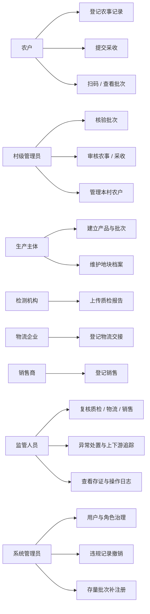

| 用例 | 前置条件 | 产出 |
| --- | --- | --- |
| 建立产品与批次 | 登录、有产品档案 | `biz_batch` 一行、批次号与溯源码、`BATCH_REGISTER` 存证 |
| 核验批次 | 批次处于待核验 | `audit_status=APPROVED`，农户才能录农事 |
| 登记农事记录 | 批次已通过核验 | `biz_planting_record` + `PLANTING_RECORD` 存证，进入村管待办 |
| 提交采收 | 该批次无待审农事 | `biz_harvest_record`，审核通过后批次转 `HARVESTED` |
| 上传质检报告 | 批次已采收 | 文件 SHA-256 + `dataHash`，合格转 `QUALIFIED`、不合格转 `ABNORMAL` |
| 登记物流交接 | 批次已质检合格 | 运单与温控记录，复核通过转 `IN_TRANSIT` |
| 登记销售 | 批次已发运 | 销售记录，复核通过转 `ON_SALE` / `SOLD` |
| 扫码溯源 | 无（免登录） | 按时间序的完整履历、报告摘要、交易凭证 |
| 异常处置与追踪 | 批次已判不合格 | 处置结果上链，支持上下游双向追溯 |

### 6.3 角色权限矩阵

`✓` 可操作 · `只读` 仅能查看 · `—` 无权限。括号内是该角色的数据边界，
权限点共 **46 个**、角色授权 **148 条**，全部落在 `sys_role_permission` 里，代码里不写死角色名。

| 能力 | 农户 | 村级管理员 | 生产主体 | 检测机构 | 物流企业 | 销售商 | 监管人员 | 系统管理员 |
| --- | --- | --- | --- | --- | --- | --- | --- | --- |
| 批次建档 / 编辑 | — | — | ✓ 本人 | — | — | — | — | ✓ |
| 批次核验 | — | ✓ 本村 | — | — | — | — | ✓ | ✓ |
| 批次查询 | 只读 本人 | 只读 本村 | 只读 本人 | 只读 关联 | 只读 关联 | 只读 关联 | 只读 全量 | ✓ 全量 |
| 农事登记 | ✓ 本人 | — | — | — | — | — | — | ✓ |
| 农事审核 | — | ✓ 本村 | — | — | — | — | — | ✓ |
| 采收登记 | ✓ 本人 | — | — | — | — | — | — | ✓ |
| 采收审核 | — | ✓ 本村 | — | — | — | — | — | ✓ |
| 质检报告上传 | — | — | — | ✓ 本机构 | — | — | — | ✓ |
| 质检复核 | — | — | — | — | — | — | ✓ | ✓ |
| 物流交接登记 | — | — | — | — | ✓ 本人承运 | — | — | ✓ |
| 物流复核 | — | — | — | — | — | — | ✓ | ✓ |
| 销售登记 | — | — | — | — | — | ✓ 本人 | — | ✓ |
| 销售复核 | — | — | — | — | — | — | ✓ | ✓ |
| 异常查看 / 上下游追溯 | — | — | 只读 | — | — | — | ✓ | ✓ |
| 异常处置 | — | — | — | — | — | — | ✓ | ✓ |
| 提交更正说明 | — | ✓ | ✓ | — | — | — | ✓ | ✓ |
| 行政村 / 地块档案 | — | ✓ 本村 | ✓ 本人地块 | — | — | — | 只读 | ✓ |
| 产品品类 | — | 只读 | ✓ | 只读 | 只读 | 只读 | 只读 | ✓ |
| 存证一致性校验 | ✓ | ✓ | ✓ | ✓ | ✓ | ✓ | ✓ | ✓ |
| 存证流水 / 存量补注册 | — | — | — | — | — | — | ✓ | ✓ |
| 用户管理 | — | ✓ 本村农户 | — | — | — | — | 只读 | ✓ |
| 操作日志 | — | — | — | — | — | — | 只读 | ✓ |
| 违规记录 / 文件撤销 | — | — | — | — | — | — | — | ✓ |
| 统计看板 | ✓ | ✓ | ✓ | ✓ | ✓ | ✓ | ✓ | ✓ |

> 矩阵里"只读"和"✓"的区别在代码里是真实存在的：只读角色拿到的是 `*:list` / `*:detail`，
> 没有 `*:create` / `*:audit`。前端按权限点隐藏按钮，后端 `@RequirePerm` 再拦一次——
> 即使手工拼请求也进不去，这一点在 [§14](#十四测试与验收) 的越权用例里有验证。

### 6.4 权限模型

**RBAC（角色-权限）+ 数据范围**，接口层用 `@RequireRoles`、`@RequirePerm` 双注解校验，越权统一 `403 / 40301`。

- 权限点 **46 个**，角色授权 **148 条**，无"有权限点没角色"的悬空授权，也无"有角色没权限点"的孤儿授权
  （`sql/versions/patch-permission-matrix.sql` 末尾自带这两项自检 SQL）。
- `*:audit` 必须与对应 `*:list` 成对授予，否则会出现"有审核权限但列表 403，按钮永远点不到"。
- **系统管理员是唯一不受权限点约束的角色**：`@RequirePerm` 在校验前直接放行 `ADMIN`，
  且 `sys_role_permission` 里始终持有全部权限点（新增权限点时由补丁脚本补齐差量）。
  这样"加一个权限点"不会出现"接口通了、菜单却看不见"的半截状态。

### 6.5 数据范围

| 角色 | 范围 | 实际可见 | 审核职责 |
| --- | --- | --- | --- |
| 系统管理员 | `ALL` | 全量 | 全部（含 `chain:repair` 存量补注册） |
| 监管人员 | `ALL` | 全量 | 质检 / 物流 / 销售复核、异常处置与结案 |
| 生产主体 | `ORG` | 本人建档的批次及其全流程记录 | — |
| 村级管理员 | `VILLAGE` | 本村批次、本村农户、本村农事/采收 | 批次核验、农事审核、采收审核 |
| 农户 | `SELF` | 本人批次与本人录入的记录 | — |
| 检测机构 | `ORG` | 本机构出具的质检报告 | — |
| 物流企业 | `ORG` | 本人承运的运单 | — |
| 销售商 | `ORG` | 本人登记的销售记录 | — |

> 数据范围不是前端过滤：分页查询、详情、看板统计、更正记录、上下游追溯全部按上表收窄。
> 农户的 `/stats/overview` 批次总量与 `/batch/page` 的 total 恒等；村管核验其他村批次直接 403。

### 6.6 管理员兜底能力

流程之外的两种"事故处理"，只有系统管理员能做。它们不是新增的业务环节，
而是给已经出错的流程留一条可追责的退路。

**（1）账号治理**

| 操作 | 接口 | 规则 |
| --- | --- | --- |
| 启用 / 停用 | `PUT /user/{id}/status` | 停用后令牌当次请求即失效（不等 12 小时过期）；不能停用自己；不能停用最后一个启用的管理员 |
| 删除 | `DELETE /user/{id}` | 仅管理员；不能删除自己；不能删除最后一个启用的管理员；逻辑删除并释放登录名 |

删除为什么是逻辑删除：批次表冗余了责任人姓名，各环节留痕里也记着操作人。
物理删行会让"这个批次当年是谁报的"永久失去答案，而答不出这个问题的溯源系统没有意义。
删除后账号立即无法登录，登录名改写为 `原名#del{id}` 以释放唯一键——
`uk_username` 不含删除标记，不改名的话重新注册同名账号会撞唯一索引，
表现为"提示账号已存在却查不到这个人"。

**（2）违规记录撤销**

| 操作 | 接口 | 说明 |
| --- | --- | --- |
| 撤销业务记录 | `POST /admin/revoke` | `bizType` ∈ 农事/采收/质检/物流/销售，必须填理由 |
| 撤销实证文件 | `POST /admin/file/{id}/revoke` | 针对单张不合规照片、无关的截图或报告 |

设计上守三条：

1. **只做链下标记**。业务记录走既有的 `deleted`，存证流水打 `revoked` 标记。
   链上数据按设计不可删，撤销表达的是"不再采信"，不是"历史没发生过"。
2. **逆序撤销**。上游记录被撤后，下游就失去了存在前提（采收撤了，质检报告凭什么出）。
   有下游有效记录时直接拒绝，并提示先撤下游——
   这正是 §7.3 修掉的"链路断裂"问题，不能从后门重新放进来。
3. **撤销后重算批次阶段**。按"当前仍然有效的已审核记录"重新推导，而不是在原状态上加减。
   否则会出现外层显示"已采收"、里层一条记录都没有的老问题。

**撤销不会让存证校验变成"数据被篡改"。** 证据摘要 `evidenceHash` 仍按**原始文件集合**重算
（`listEvidence` 返回全量，展示走 `listEvidenceVisible` 过滤撤销项），
一致性校验则跳过 `revoked=1` 的存证并把它从分母里剔除。语义上很清楚：
链上记录的是"提交当时有什么"，撤销改变的是"现在是否采信"，两者不冲突。
撤销行为本身由 `OperationLogAspect` 自动记入操作日志（操作人、IP、理由）。

---

## 七、业务流程与状态机

### 7.1 主流程：种植 → 采收 → 检测 → 运输 → 销售

任务书要求的主流程，在系统里不是"五个页面挨着点一遍"，而是**被审核卡点串起来的一条链**：
每个环节都有一道审核，审核通过才放行。这也是"批次状态"唯一可信的来源。

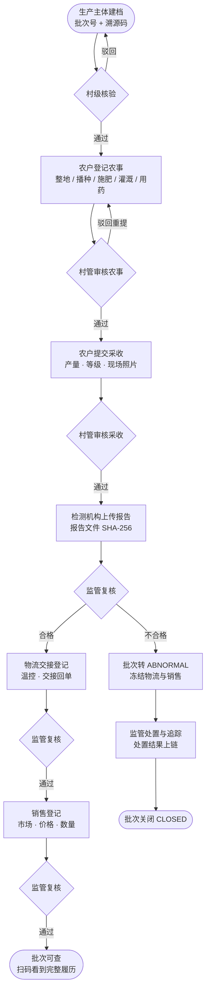

这条流程有三个特点，决定了它和"能录入就行"的系统不一样：

1. **顺序强制**：每一环都要求前一环**审核通过**才放行，而不是"上一步提交了"就放行。
   采收没审完，检测机构点上传会被 400 拒绝。
2. **审核留痕**：每次审核都记 `audit_status` + 审核人 + 时间 + 理由，驳回必须写理由，提交方可修改重提。
3. **每步上链**：提交时即存证（此时记录已是 `PENDING`），审核通过推进状态。存证与审核是两件事，
   不会因为"还没审"就没有链上凭证。

#### 七个环节：谁做、做完变成什么

| # | 环节 | 提交方 | 审核方 | 上链事件 | 完成后批次状态 |
| --- | --- | --- | --- | --- | --- |
| 1 | 批次建档 | 生产主体 | 村级管理员核验 | `BATCH_REGISTER` | `PLANTING` + 待核验 |
| 2 | 村级核验 | 村级管理员 | —（核验本身即审核动作） | 核验结果随批次事件 | 已核验，农户可录农事 |
| 3 | 农事记录 | 农户 | 村级管理员 | `PLANTING_RECORD` | 不改变批次状态 |
| 4 | 采收登记 | 农户 | 村级管理员 | `HARVEST_RECORD` | `HARVESTED` |
| 5 | 质量检测 | 检测机构 | 监管人员复核 | `QUALITY_REPORT` | 合格 `QUALIFIED` / 不合格 `ABNORMAL` |
| 6 | 物流运输 | 物流企业 | 监管人员复核 | `LOGISTICS_HANDOVER` | `IN_TRANSIT` → `ON_SALE` |
| 7 | 终端销售 | 销售商 | 监管人员复核 | `SALES_RECORD` | `ON_SALE` / 售罄 `SOLD`；批次可关闭 `CLOSED` |

> **状态推进时机**：上表的"完成后批次状态"指**审核通过之后**。提交动作本身不改变 `biz_batch.status`
> ——采收提交后批次仍是 `PLANTING`，村管审核通过才变 `HARVESTED`；质检报告上传后仍是 `HARVESTED`，
> 监管复核通过才变 `QUALIFIED`。批次状态因此只表达"已经过审核的事实"，不会出现
> "外层显示已采收、审核进度里还写着待审核"的两套说法。

### 7.2 批次状态机

```
PLANTING ──采收──> HARVESTED ──质检合格──> QUALIFIED ──发运──> IN_TRANSIT
   │                    │                                        │
   │                    └──质检不合格──> ABNORMAL <──异常处置────┘
   │                                        │
   └──────────── 销售登记通过 ──> ON_SALE ──> SOLD ──> CLOSED
```

**熔断规则**：`ABNORMAL` 状态下销售登记与物流发运都会被前置拦截（返回业务错误而不是静默失败），
必须由监管登记处置结果、处置完成后才能继续。异常与处置都上链，形成"发现问题—谁处理的—结果如何"的完整链条。

**顺序强制**：每一环都要求前置环节**审核通过**才放行，而不是"上一步提交了"就放行——

| 操作 | 前置条件 | 不满足时的返回 |
| --- | --- | --- |
| 录入农事 | 批次已通过村级核验 | 400「批次尚未通过村级核验」 |
| 提交采收 | 该批次没有待审核的农事记录 | 400「还有 N 条农事记录等待村管审核」 |
| 上传质检 | 批次状态为 `HARVESTED`（采收已审核通过） | 400「仅已采收批次可提交质检报告」 |
| 登记物流 | 批次状态为 `QUALIFIED`（质检已复核） | 400「仅已质检合格批次可发运」 |
| 登记销售 | 批次状态为 `IN_TRANSIT` / `ON_SALE`（物流已复核） | 400「仅已完成物流交接的批次可销售」 |

这样"一级一级往上走"就不只是界面上的提示，而是后端真正拦得住：采收没审完，检测机构点上传会被拒绝；
质检没复核，物流企业选不到这个批次；物流没复核，销售商提交会被打回。

### 7.3 外层状态与内层进度同源

线上曾出现"批次详情外层显示 `已采收`，点开审核进度却是 `采收登记 待审核`"。根因是旧版在**提交时**就推进了
批次状态，而明细记录仍是待审核，两套口径各说各话。现在四处展示全部由同一批业务表推导：

| 展示位置 | 数据来源 | 口径 |
| --- | --- | --- |
| 批次状态标签 | `biz_batch.status` | 只反映**已审核通过**的最高阶段 |
| 列表"待审 · 采收登记" | `/batch/page` 返回的 `pendingStage` | 后端按环节顺序算出的当前卡点 |
| 详情页卡点标签 | `/workflow/progress/{id}` 第一个未完成环节 | 与下方进度条同源 |
| 扫码溯源页 | `detailPublic` 只下发 `audit_status=APPROVED` 的记录 | 消费者看不到未审核/被驳回的数据 |

配套的数据订正脚本：`sql/versions/patch-stage-consistency*.sql`——按"已通过记录"重算历史批次状态，
并给早期演示数据里"流程已走完、审核却挂着待审"的记录补上审核留痕（`audit_by=system`），幂等可重复执行。

### 7.4 异常批次：熔断、处置与双向追踪

任务书里那条"不合格批次不得进入正常销售"，在系统里是一整套链路，不只是页面上的一个红标签：

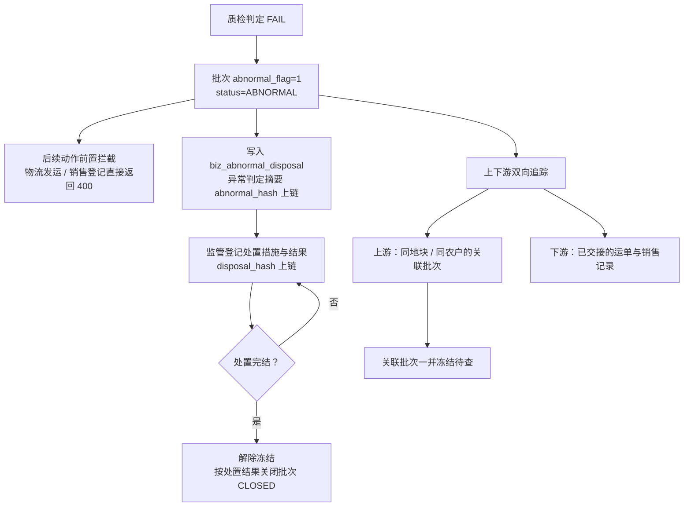

这条链上有三个容易被忽略的点，也是答辩时最能说明"不是摆设"的地方：

1. **拦截在后端，不在按钮上**。批次处于 `ABNORMAL` 时，`POST /logistics`、`POST /sales` 在 Service 层就被拒，
   返回业务错误码而不是静默失败；前端按钮只是"提前告诉你会被拒"。
2. **处置不是改状态**。处置写入 `biz_abnormal_disposal`，带处置措施、结果、处理人、时间，
   并且 `abnormal_hash` 与 `disposal_hash` 分别上链——"谁判的异常"和"谁处理的、怎么处理的"是两条不可变记录。
3. **追踪要能反向走**。按 `batch_no` 找上游看"这批货是从哪块地出来的"，
   找下游看"已经发给了谁"。这一步走的是同一张 `chain_record`，不额外建索引表。

### 7.5 提交—审核闭环（一次完整往返）

八个业务环节共用同一套闭环，以农事记录为例：

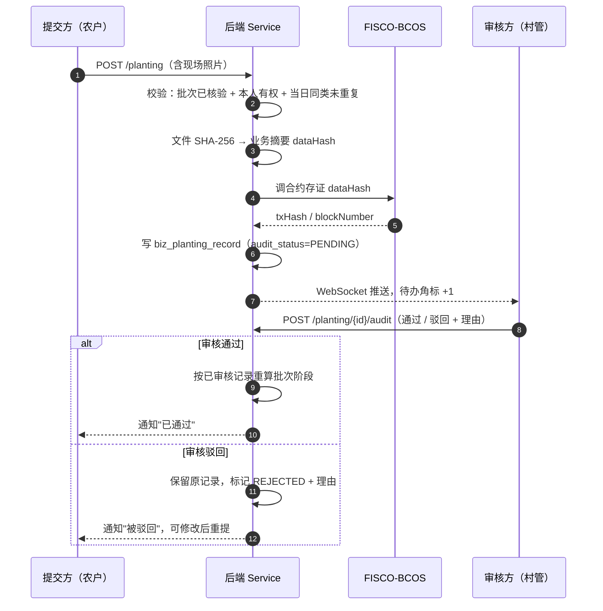

> 这套闭环为什么值得单独讲，见 [§八](#八提交审核闭环)：它解决了"提交完不知道谁来审、
> 审核完不知道提交方有没有收到"的断头路，也让每个环节的待办数量可以被准确统计。

---

## 八、提交—审核闭环

这是本系统区别于"能录入就行"的普通溯源系统的核心设计，单独用一节讲清楚。

### 8.1 三个问题

1. 提交方点了提交，页面只说"成功"——**然后呢？**
2. 审核方登录后不知道有新东西等他处理——**谁来审？**
3. 出问题时两边各说各话——**到底卡在哪一环？**

### 8.2 三个接口

| 接口 | 作用 | 权限 |
| --- | --- | --- |
| `GET /workflow/progress/{batchId}` | 七环节逐级进度：状态、提交人/时间、审核人/时间、审核意见、当前等谁 | `batch:list`（越权 403） |
| `GET /workflow/todo` | "我的审核待办"：按角色权限与数据范围聚合，只返回确实轮到他处理的数据 | 登录即可，按权限裁剪 |
| `GET /workflow/notice?bizType=&bizId=` | 提交后的提示文案：等谁、通过后进哪一环 | 提交人本人 |

三个接口共用**同一套阶段规则与数据范围**——进度说"在等村管"，村管的待办里就一定有这条；
不会出现"进度显示等审核、待办里却没有"的对不上。接口文档见 [`docs/api.md` §14b](docs/api.md)。

### 8.3 进度是怎么算的

七个环节各有 `DONE / PENDING / REJECTED / TODO / ABNORMAL` 五种状态：

- `TODO`：还没到这一步；`PENDING`：已提交、在等审核；`DONE`：已通过；`REJECTED`：被驳回；`ABNORMAL`：异常处置中。
- 百分比按**已推进环节**算（`DONE + PENDING + ABNORMAL`），不是只算"已通过"——否则已售出的批次会莫名显示 43%。
- 顶部一句话说清"现在卡在谁那里"，例如：「已提交，等待溪头村 王秀兰、曹聪（村级管理员）审核」。

### 8.4 待办怎么聚合

| 角色 | 待办内容 |
| --- | --- |
| 村级管理员 | 本村待核验批次、本村待审农事（含尚未建档的"手写作物"记录）、本村待审采收 |
| 监管人员 | 全量待复核质检 / 物流 / 销售 + 待处置异常批次 |
| 农户 / 生产主体 / 检测 / 物流 / 销售 | 无审核职责，返回空列表 |

> 村级核验只推给村管和管理员。监管虽然也持有 `batch:audit`（可介入越级核验），但"村级核验"不是他的日常职责，
> 放进待办只会把真正等他复核的质检/物流/销售顶下去。

### 8.5 驳回要能重提

- 农事实行"同类当日唯一"，但驳回记录不再占用这个名额——被驳回后可以修正重提，而不是卡死。
- 采收被驳回后批次状态回退到"种植中"，重新提交后再推进。
- 任何驳回都必须写原因，原因会通过 `audit_remark` 回传提交方，并显示在进度与列表里。

---

## 九、链上存证设计

### 9.1 合约

`contracts/Traceability.sol`（Solidity 0.6.10），核心是一个"按批次号组织的存证事件表"：

```solidity
// 简化示意
function record(string batchNo, string eventType, string dataHash, string fileHash)
    public returns (uint256 index);
function getRecordCount(string batchNo) public view returns (uint256);
function getRecord(string batchNo, uint256 index) public view returns (...);
```

- 写入：每个环节提交后写入一条，返回交易哈希与区块号，落库到 `chain_record`；
- 读取：`/chain/verify/{batchNo}` 逐条比对链上摘要与链下重算结果；
- 只追加不修改：录入错误不物理删除，走**更正记录**（`biz_correction`），更正本身也上链，历史完整保留。

### 9.2 存证事件

| event_type | 触发时机 |
| --- | --- |
| `BATCH_REGISTER` | 批次建档 |
| `PLANTING_RECORD` | 农事记录提交 |
| `HARVEST_RECORD` | 采收登记 |
| `QUALITY_REPORT` | 质检报告上传（含报告文件哈希） |
| `LOGISTICS_HANDOVER` | 物流交接登记 |
| `SALES_RECORD` | 销售登记 |
| `ABNORMAL_DISPOSAL` | 异常处置 |
| `BATCH_CLOSE` | 批次关闭 |

每张 `chain_record` 存 `batch_no / biz_type / biz_id / event_type / data_hash / file_hash / tx_hash / block_number / gas_used / status`，
`status` 取 `SUCCESS / FAILED / SKIPPED`（演示模式）。截图时全库 245 条存证、失败 0 条。

### 9.3 一致性校验与"不伪造成功"

- 链下按同样规则重算 SHA-256 与链上 `dataHash` 比对，同时校验交易回执 `status`；
- 校验失败明确提示"链上链下不一致"，并指出是哪一条；
- `chain.enabled=false` 时系统进演示模式：业务照常跑，页面标注"未上链"，`verify` 返回失败——
  **绝不把一个不存在的交易说成存证成功**。

### 9.4 链连接的工程细节

| 关注点 | 做法 |
| --- | --- |
| 断连自愈 | 客户端健康探测（3 秒缓存）+ 失败后 10 秒冷却重建 SDK 连接，**无需重启后端** |
| ABI 加载 | 走 classpath（`getInputStream`），jar 内可用，不依赖外部 `--chain.abi-path` |
| 节点托管 | 每节点一个 systemd 实例 `fisco-node@node0..3`，`Restart=always` |
| 启动顺序 | `agri-backend.service` 的 `After=/Wants=fisco-chain.target`，链先起、后端后起 |

---

## 十、溯源可信度评分 AgriTrust-5D

"上链了没有"是个二值判断，消费者看不出好坏。AgriTrust-5D 把它拆成 0–100 的五维加权分：

| 维度 | 权重 | 计分依据 |
| --- | --- | --- |
| 流程完整度 | 30 | 按批次所处阶段，考核"本应完成"的环节是否齐全（不把尚未发生的环节算作缺失） |
| 链上存证度 | 30 | 应存证条数与实际 `SUCCESS` 条数之比 |
| 质量合规性 | 20 | 质检结论 PASS/FAIL、检测项是否齐全 |
| 异常洁净度 | 15 | 是否有异常批次标记、是否已处置完成 |
| 信息完备度 | 5 | 农场、品种、报告文件等字段的完整程度 |

每条扣分都输出**可读理由**（如"缺少采收记录（-30）""档案信息缺失：农场（-1）"），消费者看到的是解释而不是一个分数。
模型细节与取舍见 [`docs/trust-score.md`](docs/trust-score.md)。

---

## 十一、数据模型

数据库按 **"权限 / 档案 / 业务 / 存证 / 支撑" 五个域** 组织，共 **19 张表**。
设计上的一条主线是：**批次是唯一主线，其余全是从属于批次的记录**——
所有业务表都冗余 `batch_no`，任何一条记录的归属不用连表就能确定。

### 11.1 实体关系图

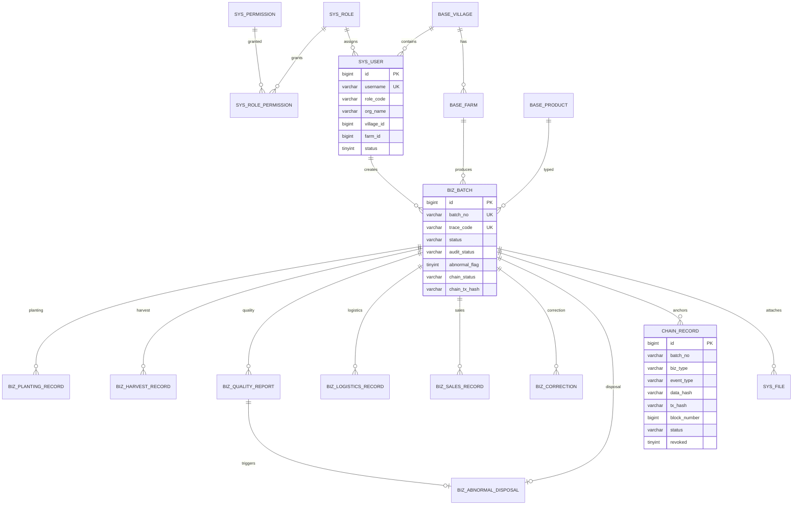

### 11.2 表清单

完整 DDL 见 [`sql/init.sql`](sql/init.sql)，种子数据见 [`sql/data.sql`](sql/data.sql)。

| 域 | 表 | 作用 | 关键字段 |
| --- | --- | --- | --- |
| **权限** | `sys_user` | 账号 | `username`、`role_code`、`org_name`、`village_id`、`farm_id`、`wx_openid`、`status`、`deleted` |
| | `sys_role` | 角色 | `role_code`、`data_scope`（`SELF/VILLAGE/ORG/ALL`） |
| | `sys_permission` | 权限点 | `perm_code`（如 `batch:create`）、`perm_type`（`MENU/BUTTON/API`）、`module` |
| | `sys_role_permission` | 角色-权限关联 | `role_code` + `perm_code` 唯一 |
| **档案** | `base_village` | 行政村 | `village_code`、`region_code`、`manager_id` |
| | `base_farm` | 农场 / 地块 | `farm_code`、`farmer_id`、`village_id`、`area`、`soil_type`、`version` |
| | `base_product` | 产品品类 | `product_code`、`category`、`variety`、`shelf_life_days` |
| **业务** | `biz_batch` | 批次主表（主线） | `batch_no`、`trace_code`、`status`、`audit_status`、`abnormal_flag`、`chain_status` |
| | `biz_planting_record` | 农事记录 | `record_type`、`operation_date`、`content`、`images`、`gps`、`location`、`audit_status`、`data_hash` |
| | `biz_harvest_record` | 采收记录 | `harvest_date`、`quantity`、`quality_level`、`weather`、`audit_status` |
| | `biz_quality_report` | 质检报告 | `report_no`、`inspect_result`、`standard_no`、`items_json`、`file_hash` |
| | `biz_logistics_record` | 物流交接 | `logistics_no`、`from_org`/`to_org`、`temperature`、`handover_file`、`status` |
| | `biz_sales_record` | 销售登记 | `market_name`、`price`、`quantity`、`buyer_name` |
| | `biz_abnormal_disposal` | 异常处置 | `abnormal_type`、`disposal_measure`、`disposal_result`、`abnormal_hash`、`disposal_hash`、`status` |
| **存证** | `chain_record` | 链上存证流水 | `batch_no`、`biz_type`、`event_type`、`data_hash`、`tx_hash`、`block_number`、`status`、`revoked` |
| | `biz_correction` | 数据更正说明 | `biz_type`、`biz_id`、`reason`、`content`（追加不覆盖） |
| **支撑** | `sys_file` | 文件元数据 | `file_path`、`file_hash`（SHA-256）、`biz_type`/`biz_id`、`revoked` |
| | `sys_operation_log` | 操作审计 | `user_id`、`module`、`action`、`request_uri`、`params`、`ip`、`cost_ms` |
| | `sys_dict` | 数据字典 | `dict_type` + `dict_code` 唯一 |

### 11.3 核心表字段设计

**（1）`biz_batch` —— 批次主表**

| 字段 | 类型 | 说明 |
| --- | --- | --- |
| `id` | BIGINT PK | 主键 |
| `batch_no` | VARCHAR(40) UK | 批次唯一编码，`AG + yyyyMMdd + 3 位当日序号` |
| `trace_code` | VARCHAR(64) UK | 溯源唯一码，二维码内容，与批次号一一对应 |
| `product_id` / `product_name` / `variety` | BIGINT / VARCHAR | 品类与品种（冗余名称，列表免连表） |
| `farm_id` / `farm_name` | BIGINT / VARCHAR | 产地地块 |
| `farmer_id` / `farmer_name` | BIGINT / VARCHAR | 责任农户 |
| `village_id` / `village_name` | BIGINT / VARCHAR | 所属行政村（数据范围 `VILLAGE` 的依据） |
| `planting_date` / `harvest_date` | DATE | 种植 / 采收日期 |
| `quantity` / `unit` | DECIMAL(12,2) / VARCHAR(16) | 数量与单位 |
| `status` | VARCHAR(24) | `PLANTING / HARVESTED / QUALIFIED / IN_TRANSIT / ON_SALE / SOLD / ABNORMAL / CLOSED` |
| `audit_status` / `audit_by` / `audit_time` / `audit_remark` | — | 村级核验的留痕 |
| `abnormal_flag` | TINYINT | 1 = 异常批次，熔断判断只看这一位 |
| `chain_status` / `chain_tx_hash` / `block_number` | — | 建档存证结果，`NONE/SUCCESS/FAILED` |
| `create_by` / `create_time` / `update_time` / `version` / `deleted` | — | 审计字段 + 乐观锁 + 逻辑删除 |

**（2）五张业务记录表的公共字段**

`biz_planting_record`、`biz_harvest_record`、`biz_quality_report`、`biz_logistics_record`、`biz_sales_record`
结构不同，但下面这组字段**每张表都有**，这是"审核闭环 + 存证"能统一实现的原因：

| 字段 | 说明 |
| --- | --- |
| `batch_id` / `batch_no` | 归属批次（`batch_no` 冗余，支持按码直查） |
| `operator_id` / `operator_name` / `提交人` | 谁提交的（质检为 `inspector_*`、物流为 `carrier_*`、销售为 `seller_*`） |
| `audit_status` / `audit_remark` | `PENDING / APPROVED / REJECTED`，驳回必须带理由 |
| `data_hash` | 业务摘要 SHA-256，字段按固定顺序序列化后计算 |
| `chain_status` / `chain_tx_hash` / `block_number` | 本条记录的存证结果 |
| `images` / `file_path` / `file_hash` | 现场实证或报告文件（质检报告另存 `file_hash`） |
| `create_time` / `deleted` | 审计与逻辑删除 |

**（3）`chain_record` —— 链上存证流水**

| 字段 | 说明 |
| --- | --- |
| `batch_no` | 批次号（跨批次查询的主键） |
| `biz_type` | `BATCH / PLANTING / HARVEST / QUALITY / LOGISTICS / SALES / ABNORMAL / DISPOSAL / CORRECTION` |
| `event_type` | 链上事件名，与合约事件一一对应 |
| `data_hash` / `file_hash` | 业务摘要与文件摘要 |
| `tx_hash` / `block_number` / `gas_used` | 交易回执，**写入成功以回执为准**，不看 HTTP 200 |
| `chain_index` | 记录在合约中的下标，一致性校验按它对位 |
| `contract_address` | 合约地址，支持多版本合约路由 |
| `status` | `SUCCESS / FAILED / SKIPPED`；`revoked` 标记"不再采信" |
| `error_msg` | 失败原因原文，演示模式下的真实凭据 |

### 11.4 建表约定

| 约定 | 做法 | 为什么 |
| --- | --- | --- |
| 逻辑删除 | 业务表统一 `deleted TINYINT`，MyBatis-Plus 自动拼接 | 溯源的"历史"不能被物理抹掉 |
| 乐观锁 | 批次、地块、异常处置带 `version` | 两个村管同时审核同一批次，后提交的会失败而不是覆盖 |
| 名称冗余 | 批次表存 `farmer_name` / `village_name` / `product_name` | 列表与溯源页免连表，且主体改名后历史记录仍显示当时的名字 |
| 索引 | `idx_batch`、`idx_status`、`idx_village`、`idx_batch_no` | 覆盖"按批次查、按状态筛、按村过滤"三类主查询 |
| 唯一键 | `batch_no`、`trace_code`、`report_no`、`username` | 重复批次在这里就被数据库挡住，不靠代码判断 |
| 金额与数量 | `DECIMAL(12,2)`，不用 FLOAT | 避免浮点误差导致"同一批次两次统计对不上" |

### 11.5 批次编码规则

**批次号**：`AG + yyyyMMdd + 3 位当日序号`（如 `AG20261109011`）。
**溯源码**：`TC + 同序号`（如 `TC20261109011`），与批次号一一对应，二维码内容就是溯源码。

两者都建了唯一键——**重复批次不需要业务代码判断，数据库直接拒绝**。
这一点在 [§14](#十四测试与验收) 的"重复批次"用例里验证过：并发提交同一天第 11 个批次，只有一个能成功。

---

## 十二、接口概览

| 分组 | 代表接口 | 说明 |
| --- | --- | --- |
| 认证 | `POST /auth/login`、`/auth/register`、`/auth/refresh`、`/auth/profile` | JWT 12h + refresh 7d，`typ` 声明隔离 |
| 批次 | `GET /batch/page`、`GET /batch/{id}`、`POST /batch`、`POST /batch/{id}/audit`、`POST /batch/{id}/close` | 分页/详情/建档/核验/关闭 |
| 农事 | `POST /planting`、`GET /planting/page`、`POST /planting/{id}/audit` | 提交、列表、审核 |
| 采收 | `POST /harvest`、`POST /harvest/{id}/audit` | 同上 |
| 质检 | `POST /quality`、`POST /quality/{id}/audit` | 含报告文件哈希 |
| 物流 | `POST /logistics`、`POST /logistics/{id}/audit` | 含温控、交接单 |
| 销售 | `POST /sales`、`POST /sales/{id}/audit` | 熔断在服务层 |
| 审核流 | `GET /workflow/progress/{batchId}`、`/workflow/todo`、`/workflow/notice` | 见 [§8](#八提交审核闭环) |
| 溯源 | `GET /trace/{code}`（免登录）、`GET /trace/verify/{batchNo}` | 扫码落地页数据 |
| 链 | `GET /chain/status`、`/chain/page`、`/chain/verify/{batchNo}`、`POST /chain/repair` | 状态、流水、校验、补注册 |
| 统计 | `GET /stats/overview` | 按数据范围收窄 |
| 文件 | `POST /file/upload`、`GET /file/download/{id}`、`GET /file/evidence` | 落盘 + 摘要；撤销后下载返回 403 |
| 账号治理 | `PUT /user/{id}/status`、`DELETE /user/{id}`、`GET /user/pending`、`POST /user/{id}/audit` | 启停、删除、注册审核，见 [§6.6](#66-管理员兜底能力) |
| 兜底处置 | `POST /admin/revoke`、`POST /admin/file/{id}/revoke` | 撤销违规记录与证据，仅系统管理员 |

完整入参/出参/权限见 [`docs/api.md`](docs/api.md)，在线文档 `/api/doc.html`（Knife4j）。

---

## 十三、部署与运维

单机 ECS 上的实际形态（`ops/` 内即线上在用的那一份；链账户私钥、数据库口令、JWT 密钥已抽到 `backend.env`，单元文件本身不含任何密钥）：

> **`sql/init.sql` 是"从零建库"脚本，内含 `USE agri_trace` 与 `DROP TABLE`，在已有数据的库上执行会清空全部业务数据。**
> 存量环境只应执行 `sql/versions/patch-*.sql` 增量补丁，且执行前必须先备份。
> 若只是校验脚本语法，请另起一个 MySQL 实例，不要连生产库。

| 关注点 | 做法 | 对应文件 |
| --- | --- | --- |
| 链节点托管 | 每节点一个 systemd 实例，`Restart=always`；不用 `build_chain` 的 `start.sh`（它按进程名判活，四节点共用一个二进制路径，只掉三个会被误判为"已运行"） | `ops/fisco-node@.service`、`ops/fisco-chain.target` |
| 启动顺序 | 后端 `After=/Wants=fisco-chain.target` | `ops/agri-backend.service` |
| 链断连自愈 | 健康探测 + 10 秒冷却重建 SDK，无需重启后端 | `BcosClient` |
| WebSocket | nginx 单独给 `location = /api/ws` 配 `Upgrade`/`Connection` 与 1 小时读超时 | `ops/nginx-agri-origin.conf` |
| 握手鉴权 | 无 token / 非法 token 一律 401（只 `return false` 会得到 200，客户端无法区分鉴权失败与服务异常，会无限重连） | `WsHandshakeInterceptor` |
| 链可视化 | WeBASE-Front 只监听 `127.0.0.1:5002`，nginx 反代 + Basic 认证（它没有登录且能用节点私钥签交易，不能裸奔公网） | `ops/webase-front.service` |
| 日志轮转 | systemd `append` 不轮转，配 `logrotate`（`copytruncate`，否则进程写旧 inode） | `ops/logrotate-agri-origin.conf` |
| 密钥管理 | 私钥/口令/密钥统一放 `backend.env`（`600`），`EnvironmentFile=` 注入；缺失或私钥为空则拒绝启动 | `ops/agri-backend.service`、`ops/backend.env.example` |
| HTTPS | 用 `8-130-105-150.sslip.io` 解析回源 IP，免域名签发受信任证书；80 全部 301 到 443（**扫码必须 HTTPS**，否则浏览器不给摄像头）。443 分两个 server：域名站发完整链（`agri-fullchain.crt`，叶子+中间证书）。裸 IP 没有公共证书（CA 不给纯 IP 签发），单独做 `default_server`，用 SAN=`IP:8.130.105.150` 的自签证书接住握手后立刻 301 到域名——用户点一次"继续前往"即可，不会再停在"证书名字不对"的死页面 | `ops/nginx-agri-origin.conf`、`scripts/fix-https-ip.py` |

### 13.1 一次真实故障复盘：链上批次号不能复用

线上曾出现「村管点审核通过 → 弹窗“上链失败，操作已回滚：交易执行失败：batch already exists”」。这不是审核权限或前端问题，而是**编号分配与链上不可删除特性冲突**：

- 合约 `registerBatch` 的校验是 `require(!_batches[batchNo].exists, "batch already exists")`，同一批次号只能注册一次；
- 原编号规则是「当日批次数 + 1」，删除过测试批次后会回退（库里剩 `001`、`011` 时 `count=2` → 又生成 `003`）；
- 数据库里删得掉，链上删不掉：`003` 是历史批次用过的号，于是补档/建档写链必然 revert，整笔审核事务回滚。

修复分三层，任何一层都能独立兜住：

1. **按最大序号递增**：取当日 `batch_no` 最大值 +1，而不是按条数，删除后不会回退；
2. **分配前问链**：候选号先用 `batchExistsOf` 探一次，链上已占用就跳过（这类“库已删、链仍在”的孤儿号会永久占位）；
3. **写链撞号重试**：`registerBatch` 若仍返回 `batch already exists`，自动换下一个可用号、重算摘要重写，最多 3 次；其它链上错误（未授权、节点不可用）原样抛出，不掩盖真问题。

同时把合约的英文 revert 翻译成可操作的中文提示（如“该批次号已在链上存证（历史批次占用），换个批次号重试即可”），避免界面出现半截英文。

> 结论：WeBASE-Front 只是链的可视化控制台，不参与业务写链，也不是本次故障来源；链上 4 节点、296 区块、248 条存证全部正常。

### 13.2 移动端 App（Android 安装包）

线上 H5 已能直接在手机浏览器使用，但答辩与现场演示需要"装机可点"的图标，因此额外产出一个 Android 安装包，放在 `https://8-130-105-150.sslip.io/portal/download/` 供扫码下载。

**形态**：全屏 `WebView` 外壳（`frontend/app-shell/src/com/agri/trace/MainActivity.java`），加载同域 H5，补齐浏览器给不了的原生能力——相机与定位运行时授权、`getUserMedia` 权限自动授予、文件选择（拍照/相册上传）、`DownloadManager` 下载、物理返回键逐页回退、断网重试页、启动图与桌面图标。它**不是** DCloud 云打包的 uni-app 原生包（那条路需要真实 appid + 账号登录 + 付费/排队），功能上与 H5 一致，差别是没有原生插件与离线缓存。

**构建**（无需 Android Studio / Gradle，直接用 SDK 命令行工具链）：

```bash
bash frontend/app-shell/tools/build.sh          # aapt2 → javac → d8 → zipalign → apksigner
node frontend/app-shell/tools/render-icons.js   # 改图标时重跑：品牌 SVG → 各密度 mipmap
```

- 工具链与签名证书在仓库外：`C:\Users\30786\AppData\Local\agri-android`（JDK 17、`sdk/`、`agritrace.keystore`、`keystore.properties`）。**证书丢了就无法覆盖升级**，换机前先备份这两个文件。
- 产物：`frontend/app-shell/out/agritrace-1.0.0.apk`（约 454 KB，`com.agri.trace`，minSdk 23 / targetSdk 34）。
- 发布：把 `out/*.apk` 与 `frontend/app-shell/download/` 下的 `index.html`、`qr.svg`、`icon-192.png` 一并上传到 `/opt/agri-origin/web/portal/download/`。下载页由 nginx 的 `location /portal/` 直接托管，无需改配置。
- App 启动地址是 `MainActivity.APP_URL`，指向 `/pages/launch/index`（直接进应用，不再落到门户宣传页），域名变更需改常量后重新构建。
- `Content-Type` 为 `application/octet-stream`（nginx 默认未登记 apk），浏览器按后缀下载与安装，不影响使用；微信内打开会拦截下载，下载页已给出"用浏览器打开"的提示。

> 升级注意：`versionCode` 只在 `build.sh` 顶部的 `VER_CODE` 改，构建时会自动写进 `AndroidManifest.xml`（清单里写死值会盖掉 aapt2 的 `--version-code`，改脚本却没生效）。每次发版递增，否则同版本号安装会被系统拒绝。签名必须沿用同一份证书。

#### App 专属页面（与 H5 / 小程序分流）

壳加载的是**同一份 H5 产物**，编译期无法用 `#ifdef APP-PLUS` 区分，因此改为运行时识别：壳在 UA 末尾追加 `AgriTraceApp/<版本>`，并注入 `window.AgriTraceNative` 兜底；前端 `config/platform.js` 的 `isAppShell()` 据此判断。

| 页面 | 浏览器 / 小程序 | 壳内 App |
|---|---|---|
| 启动落地 | `pages/auth/login` → `pages/tabbar/home` | `pages/app/login` → `pages/app/home` |
| 登录 | `pages/auth/login`（宽屏自动切 PC 版式） | `pages/app/login`（整屏品牌 + 上浮面板） |
| 注册 | `pages/auth/register` | `pages/app/register`（先选身份）→ 复用原表单 |

- App 首页是独立页而不是 tabBar 页：沉浸式头部 + 上浮白色面板 + 横向滑动批次卡 + 自绘 Dock（中间凸起扫码），没有系统标题栏，因此打开不像网页。
- 底部导航在壳内统一：`components/app/app-dock.vue` 一块 Dock 同时挂在 `pages/app/home` 与四个 tab 页上，系统 tabBar 由 `body.agri-app-shell` 的样式隐藏（标记在 `main.js` 挂载前打，避免首帧闪一下四格）。早期只有首页是五格、切到"批次/我的"就变成系统四格，来回切还会停在四格版本上。
- 分流点只有三处：`pages/launch/index.vue` 的落地跳转、`pages/auth/login.vue` 的 `onLoad`/`afterLogin`/`toRegister`、`pages/auth/register.vue` 的 `role` 预选与注册后落地。全部包在 `#ifdef H5` + `isAppShell()` 双条件里，**小程序与浏览器行为完全不变**（已验证：普通手机 UA 仍落 `pages/auth/login`，桌面 UA 仍进 PC 版式）。
- App 专属页被浏览器直接访问时会自行退回通用页（`onLoad` 守卫），不会出现半成品界面。
- 注册表单仍只有一份（`pages/auth/register.vue`），App 的"选择身份"页只负责传 `?role=`，避免两套校验逻辑走偏。身份清单统一在 `config/roles.js`。

#### 三端各自的界面与启动感

三端共用一套业务逻辑，界面按"端"分开表达，功能一条都没分叉：

| | 浏览器（手机 / 电脑同一套响应式） | 微信小程序 | 安装包 App |
|---|---|---|---|
| 设计取向 | 克制、信息密度优先，和后台一致 | 轻快、单手可达 | 沉浸、贴近原生应用 |
| 启动时长 | 回访 1.3s / 首见 1.9s | 回访 1.0s / 首见 1.45s | 回访 1.7s / 首见 2.0s |
| 启动动画 | 标识涟漪扩散 | 轻量涟漪 | 标识背后呼吸光晕 + 一正一反两道旋转细弧 + 标识浮起、标题由虚转实对焦进场（涟漪在 App 内收起） |
| 启动页底部说明 | `FISCO-BCOS 联盟链 · 全流程上链存证` | `微信小程序 · 无需下载安装` | `正在进入应用 · AGRI-ORIGIN` |
| 首屏 | `pages/tabbar/home` 或 PC 控制台 | `pages/tabbar/home` | `pages/app/home`（自绘 Dock） |
| 底部导航 | 系统 tabBar（四格） | 系统 tabBar（四格） | 自绘 Dock（五格，中间凸起扫码），四个 tab 页共用同一组件 |

判定方式：小程序端用 `#ifdef MP-WEIXIN`（**编译期真生效**，已核对产物里只剩 `plate="mp"` 分支）；App 壳用 `isAppShell()`；其余一律按浏览器处理。三者只影响 `plate` 这个视觉变量和 `holdMs` 这个时长，跳转目标仍由原来的 `isPcWidth()` / `isAppShell()` 决定。

**启动页的底色**：`pages/launch/index` 的页面背景设为 `#0B3D26`，从官网遮罩切过来时新文档在 SPA 挂载前先刷的是这层深绿而不是 `#f4f6f8`；`index.html` 里再用 `html.agri-boot` 把「从官网过来这一跳」的文档底色压成同一块深绿，挂载后由启动页摘掉，实测切换过程中心亮度 >150 的「发白帧」为 0。

**官网 → 业务系统的过渡**：`portal/index.html` 拦截站内 `/pages/` 链接，先播一屏品牌遮罩（logo + 进度条走满约 0.62s）再切页，避免白屏硬切；下载页、锚点、外链一律不拦。过渡会在 `sessionStorage` 留一个 `agri_portal_hop` 标记，启动页读到后**不再重播品牌动画**，而是用同一构图（同底色、同标识尺寸、同文案位置）把画面接住，停 0.42s 就进系统。

**为什么不是"播两遍"**：跨文档这一跳里有两段真空——新文档从 HTML 到达（~150ms）到 SPA 挂载（~400ms+）之间 `#app` 是空的。遮罩一播完就消失、启动页再画一遍，用户看到的就是"过场演了两次"。现在 `index.html` 在 `<body>` 里放了一张与门户遮罩**逐像素同构**的静态幕布 `#agri-curtain`（尺寸/间距/颜色/渐变全部照抄 `.rv-*`，标识直接用门户那份 SVG 内联，不走图片请求，弱网也不会出现"只有字没有图标"），解析阶段就画出来，早于任何 JS；启动页 `onMounted` 的下一帧才把它摘掉（`requestAnimationFrame` 里摘，onLoad 摘会闪一帧黑）。接力块里的进度条固定满格、不带任何动画，所以全程**只有一条进度条、一次过场**。实测（1440/390 各 70 拍）：层次序列只有 `遮罩 → 幕布 → 接力 → 登录`，中间没有空档帧，进度条回缩 0 次，`.center` 帧 0；幕布与门户遮罩的标识/名称/进度条位置最大偏差 2px。弱网（1.5Mbps / 300ms 往返）下幕布同样带完整标识出现。

> 直接输入地址访问（没有 `agri_portal_hop` 标记）时幕布不显示、启动页照常播完整品牌动画；App 壳内同理，不受影响。

**启动页进度条的时序**：三端的停留时长、进度条入场延迟与走完时刻统一在 `launch/index.vue` 的 `plan()` 里算：进度条与底部文字同时出现，走满后再停 80ms 才淡出。早期版本里进度条元素一挂载就开始计时，但容器要等 0.4~0.95s 才淡入，结果是"看不见时已经走了大半"，观感上像"条没走完就进主界面"。

**App 点开瞬间的衔接**（这三处必须同时成立，缺一个就会闪）：
1. `styles.xml` 的 `windowBackground` 是启动图：品牌深绿底 + 居中标识；
2. `WebView` 背景色设为同一个深绿（原来留的是浅灰 `#F4F7F5`，页面没渲染出来前会白一下）；
3. 启动页首帧底色也是 `#0B3D26`，渐变由单独一层淡入；`plate === 'app'` 时标识固定 120px 且**中点落在屏幕中线**，与启动图的位置和尺寸完全一致，所以看到的是"标识没动，周围亮了起来"，而不是"网页重新加载一次"。

**App 首页进场**：品牌栏 → 问候 → 统计 → 待办 → 宫格 → 批次 → Dock 依次淡入上浮，只动 `opacity` 与 `transform`，不占位、不拦点击；`prefers-reduced-motion: reduce` 下直接给终点状态。

> 顺手修掉一处旧问题：`pages/tabbar/home.vue` 右上角光斑用 `right:-100rpx` 探出容器，把手机端的文档撑到 442px（390 屏），页面能左右拖、底部错位。给 `.header` 加 `overflow: hidden` 裁掉探出部分后，`scrollWidth` 回到 390。


---

## 十四、测试与验收

| 脚本 | 覆盖内容 |
| --- | --- |
| `scripts/e2e-acceptance.py` | 8 角色登录 → 全流程真实上链 → 异常熔断 → 越权负例 → 数据范围隔离，49 项断言，任一失败非零退出 |
| `scripts/verify-full-chain.py` | 五个自助注册账号从建地块到售出，验证"新注册的人能不能真的把一批菜走完" |
| `scripts/verify-audit-flow.py` | 审核流：村管可见性、待办归属、审核留痕、进度推进 |
| `scripts/verify-auth-cache.py` | 权限缓存一致性（改角色后无需重启即生效） |
| `scripts/verify-handwrite-batch.py` | 农户手写作物 → 村管审核 → 自动建档 |
| `scripts/verify-register-login.py` / `verify-self-register.py` | 自助注册、限流、登录闭环 |

已在线上回归的关键场景：

- 村管农事列表曾因查询条件拼接错误恒为空（农户提交成功、村管看不到），修复后本村 58 条全部可见，链路上第一环不再断；
- 采收驳回后可重提、批次状态回退；
- 质检不合格 → 销售登记被拦截 → 监管处置 → 上下游追溯定位责任主体；
- 农户账号调质检接口 → 403；重复提交采收 → 409；重复同类农事 → 409。

---

## 十五、快速启动与演示

### 15.1 演示账号

| 账号 | 密码 | 角色 | 说明 |
| --- | --- | --- | --- |
| `admin` | `123456` | 系统管理员 | 全部权限，含链上补注册 |
| `producer01` | `123456` | 生产主体 | 建档、指派农户 |
| `farmer01` | `123456` | 农户（溪头村） | 农事、采收 |
| `farmer02` | `123456` | 农户（上寨村） | 用于验证村级数据隔离 |
| `village01` | `123456` | 村级管理员 | 本村核验与审核 |
| `inspector01` | `123456` | 检测机构 | 质检报告 |
| `logistics01` | `123456` | 物流企业 | 运输交接 |
| `seller01` | `123456` | 销售商 | 销售登记 |
| `regulator01` | `123456` | 监管人员 | 复核与异常处置 |

### 15.2 本地启动

**环境要求**：JDK 8+、Maven 3.6+、Node.js 18+、MySQL 8.0+、FISCO-BCOS 2.9.1（可用 `build_chain.sh` 一键搭 4 节点单群组）

```bash
# 1. 数据库
mysql -uroot -p -e "CREATE DATABASE agri_trace DEFAULT CHARSET utf8mb4 COLLATE utf8mb4_general_ci;"
mysql -uroot -p agri_trace < sql/init.sql
mysql -uroot -p agri_trace < sql/data.sql

# 2. 合约
cd contracts && npm install && npm run compile    # 生成 abi/ bin/
# 将 abi/Traceability.abi 与 bin/Traceability.bin 交给 FISCO console 部署
# 把合约地址写入 backend/src/main/resources/application.yml -> chain.contract-address

# 3. 后端
cd backend && mvn clean package -DskipTests
java -jar target/agri-trace-backend.jar           # 接口文档 http://localhost:8080/api/doc.html

# 4. 前端（三端统一工程）
cd frontend/uni-app && npm install
npm run dev:h5          # http://localhost:5173，宽屏自动 PC / 窄屏自动移动
npm run dev:mp-weixin   # 产物 dist/dev/mp-weixin，微信开发者工具导入
npm run dev:app         # 产物 dist/dev/app，HBuilderX 运行到手机
```

> 无链环境也能跑：`chain.enabled=false` 进演示模式，业务全通，页面如实标注"未上链"，一致性校验返回失败。
> 微信登录未配 appid/secret 时按端进入 mock 模式，可完整验证"首次绑定 → 直接登录 → 解绑"，日志显式标注，不伪装成真实微信登录。

### 15.3 十分钟演示路径（建议按这个顺序讲）

1. **农户**（手机）登录 → 选批次 → 新增农事（拍照上传）→ 提交后弹出「已提交，等待溪头村 王秀兰、曹聪（村级管理员）审核」；
2. **村管**（PC）登录 → 工作台提示"有 N 项待你审核" → 进「审核待办」→ 通过（或填原因驳回）；
3. 回到**批次详情**看进度条从"农事待审"变成"农事已完成"，并显示审核人姓名与时间；
4. **检测机构**上传质检报告（合格）→ 批次转"检测合格" → **监管**在待办里复核；
5. **物流企业**登记发运 → **销售商**登记销售 → 批次"销售中"；
6. **消费者**手机扫码（或打开 `/pages/trace/index?code=TC20261109011`）→ 可信度评分 + 时间轴 + 链上凭证 + 一键一致性校验；
7. 演示异常：另建批次质检"不合格" → 销售登记被拦截 → 监管处置 → 上游来源与下游流向定位责任主体；
8. 演示越权：农户账号调质检接口 → 403；重复提交采收 → 409。

### 15.4 线上入口

| 入口 | 地址 | 说明 |
| --- | --- | --- |
| 官网门户 | <https://8-130-105-150.sslip.io/> | 平台介绍 + 业务系统入口 |
| 业务系统 | <https://8-130-105-150.sslip.io/pages/launch/index> | 9 个演示账号，密码 `123456` |
| 免登录溯源 | <https://8-130-105-150.sslip.io/pages/trace/index?code=TC20261109011> | 消费者扫码落地页 |
| App 下载 | <https://8-130-105-150.sslip.io/portal/download/> | Android 安装包 454 KB，手机扫码即可装 |
| 链上控制台 | <https://8-130-105-150.sslip.io/WeBASE-Front/> | 账号 `webase` / `Agri@2026` |

---

## 十六、仓库结构

```
agri-origin/
├── backend/                    # Spring Boot 后端（后端开发只关注此目录 + /sql）
│   └── src/main/java/com/agri/trace/
│       ├── controller/         # 接口层
│       ├── service/            # 业务逻辑（WorkflowService 是审核流引擎）
│       ├── mapper/             # MyBatis-Plus 数据访问
│       ├── entity/ dto/ vo/    # 实体 / 入参 / 出参
│       ├── security/           # JWT、@RequirePerm、数据范围上下文
│       ├── sdk/                # FISCO-BCOS 封装（唯一链交互出口）
│       └── common/             # 统一响应、异常、常量
├── frontend/
│   ├── uni-app/                # 三端统一工程（H5 / 微信小程序 / App）
│   │   ├── src/pages/          # 移动端页面（含 App 壳内专属页 pages/app/）
│   │   ├── src/pages-pc/       # PC 管理端页面（16 页）
│   │   ├── src/components/     # 业务组件（workflow-steps、pc-workflow、evidence-uploader…）
│   │   ├── src/composables/    # useForm / usePage 等通用逻辑
│   │   └── scripts/            # 截图与端到端脚本
│   └── app-shell/              # Android 安装包外壳（WebView + 原生能力，见 13.2）
│       ├── src/                # MainActivity（相机/定位/文件/下载/返回键）
│       ├── res/                # 图标、启动图、主题
│       ├── tools/              # build.sh 构建、render-icons.js 出图标
│       └── download/           # 下载页与 apk（上传到 /portal/download/ 的那一份）
├── contracts/                  # Solidity 合约、ABI/BIN、编译部署脚本
├── ops/                        # 生产部署配置（systemd、nginx、logrotate）
├── scripts/                    # 验收与运维脚本（e2e-acceptance、verify-*）
├── sql/                        # init.sql、data.sql、增量补丁
│   └── versions/               # patch-wx-login / patch-optimistic-lock /
│                               # patch-permission-matrix / patch-audit-trail
├── docs/                       # 说明、部署、接口、测试、评分模型
│   └── assets/screenshots/     # 本文所有截图（uni-pc / uni）
└── portal/                     # 官网门户静态页（只接管根路径）
```

---

## 十七、文档索引

- [docs/README.md](docs/README.md) —— 项目详细说明与架构图
- [docs/deploy.md](docs/deploy.md) —— 部署手册（本地 / 云服务器 / 链节点 / HTTPS）
- [docs/api.md](docs/api.md) —— 接口说明（入参、出参、权限）；审核流见 §14b
- [docs/trust-score.md](docs/trust-score.md) —— AgriTrust-5D 计分规则与设计取舍
- [docs/uni-app-migration.md](docs/uni-app-migration.md) —— 三端改造方案与落地清单
- [docs/test.md](docs/test.md) —— 验收用例（正常流转、异常拦截、越权、重复提交、一致性）
- [contracts/README.md](contracts/README.md) —— 合约设计与部署
- [docs/WeBASE-Front-HTTP调用实战.md](docs/WeBASE-Front-HTTP调用实战.md) —— 第二种链上接入方式
- [docs/assets/README.md](docs/assets/README.md) —— 流程图、用例图、素材说明

---

## 十八、开发分工与许可

| 角色 | 负责目录 | 内容 |
| --- | --- | --- |
| 后端 | `/backend`、`/sql` | 业务接口、权限、审核流、链交互封装 |
| 前端 | `/frontend` | PC 管理端 + 移动 H5 + 小程序/App |
| 合约 | `/contracts` | 合约逻辑、编译部署 |
| 文档 / 测试 | `/docs`、`/scripts` | 说明、部署、接口、验收脚本 |

模块间只通过 HTTP 接口与链上合约解耦，单模块修改不影响其他目录。

## 十九、已知限制与后续计划

写在这里不是自曝其短，而是把边界说清楚——哪些是设计取舍，哪些是还没做的：

| 限制 | 现状 | 后续 |
| --- | --- | --- |
| 部署形态 | 单机 ECS，4 个链节点与后端同机（答辩与演示够用） | 生产环境应把节点分散到各参与方机房，形成真正的多机构联盟 |
| 存证粒度 | 摘要上链，明细留在 MySQL | 高价值环节（质检结论、销售核销）可考虑全量上链 |
| 文件存储 | 本地磁盘 + 文件哈希上链 | 可切 OSS/MinIO，切换只改存储实现 |
| 检测数据来源 | 检测报告由机构人工上传 | 对接 LIMS 或省级追溯平台接口，减少人工录入 |
| 链上治理 | 单群组、固定节点、无准入合约 | 增加节点准入与权限合约，支持动态增删机构 |
| 移动端发布 | H5 已上线；小程序 / App 已出包但未上架 | 补小程序类目资质与隐私协议后提交审核 |

---

[MIT](LICENSE) © 2026 agri-origin
