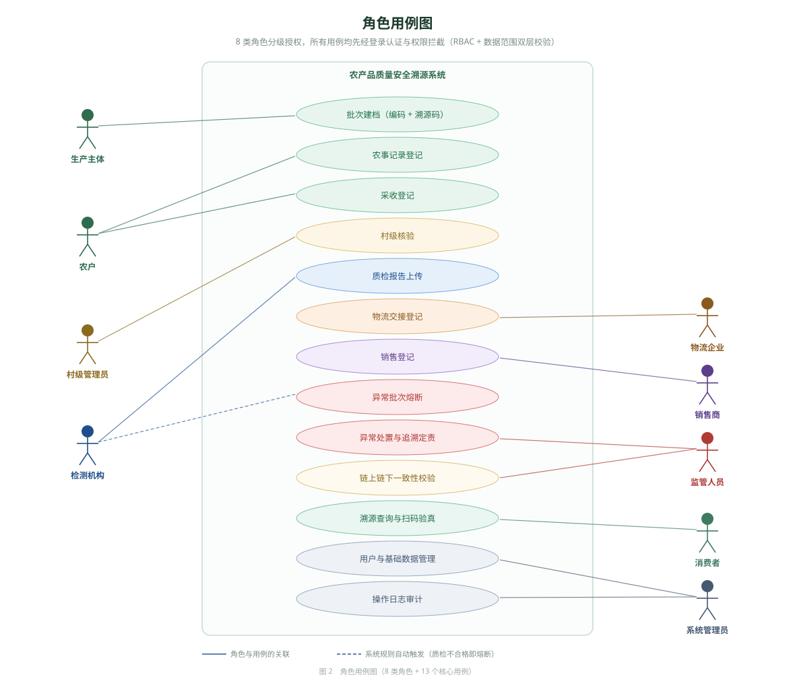
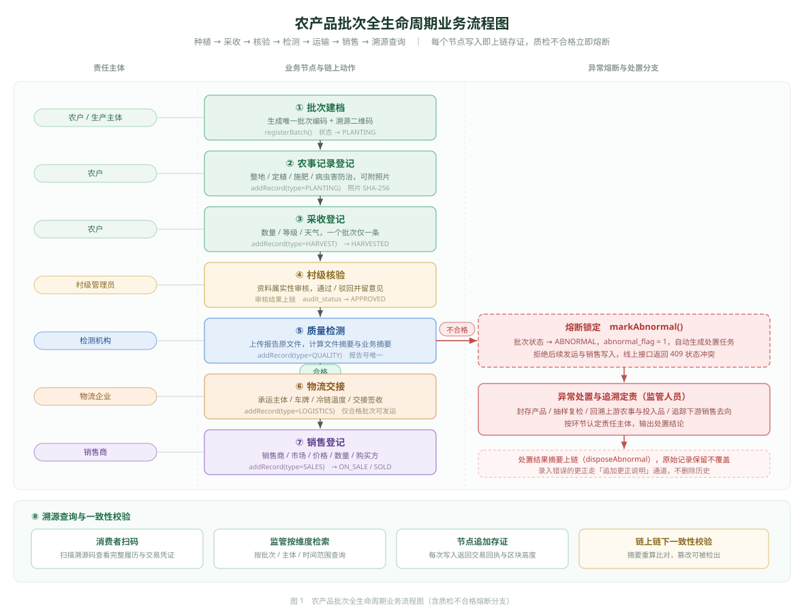

# 农产品质量安全溯源系统 · 设计文档

> 基于 FISCO-BCOS 联盟链的农产品质量安全溯源系统 · 设计与实现说明
> 版本 v1.0.0 · 适用于毕业设计交付与答辩演示

---

## 一、文档索引

| 文档 | 说明 | 读者 |
| --- | --- | --- |
| [README.md](./README.md) | 系统概述、架构设计、角色权限、功能与数据模型 | 全员 / 答辩评审 |
| [deploy.md](./deploy.md) | 环境依赖、数据库初始化、合约部署、前后端启动、生产部署 | 运维 / 开发 |
| [test.md](./test.md) | 全量验收测试用例（正常流转、越权、异常熔断、一致性校验） | 测试 / 答辩演示 |
| [api.md](./api.md) | REST 接口清单、入参出参、权限要求、错误码 | 前后端开发 |
| [uni-app-migration.md](./uni-app-migration.md) | 前端 uni-app 三端（H5 / 微信小程序 / App）改造方案：目录重构、代码迁移映射、请求与扫码封装、登录打通、打包发布、排查规范 | 前端开发 / 答辩评审 |
| [assets/README.md](./assets/README.md) | 流程图/用例图源文件、模拟质检报告与农产品图片素材说明 | 答辩演示 |
| [../contracts/README.md](../contracts/README.md) | 智能合约结构、方法清单、编译与部署 | 链端开发 |
| [../README.md](../README.md) | 项目总览与 10 分钟快速验收路径 | 全员 |

---

## 二、项目背景与目标

### 2.1 现实问题

农产品从田间到餐桌要经过种植、采收、质检、物流、销售等多个主体，环节数据分散在各主体自有系统中，存在三个突出问题：

1. **数据可被单方修改** —— 传统中心化数据库中，掌握写权限的一方可以无声修改历史记录，事后无法举证；
2. **责任主体难以定位** —— 出现质量问题时，上下游交接记录缺失，无法判断问题出在种植、运输还是销售环节；
3. **消费者无法验证** —— 包装上的"溯源二维码"往往只跳转到一个可自由编辑的页面，缺乏可信性证明。

### 2.2 解决思路

引入 **FISCO-BCOS 联盟链**作为可信底座，只把"关键业务记录 + 文件摘要"上链，业务明细仍存 MySQL：

- **链上存证，链下存储**：链上保存 64 位 SHA-256 摘要和业务关键字段，链下保存完整明细。链上数据量小、性能好，同时具备不可篡改特性；
- **摘要可复算**：任何人都能按公开规则（见 §6.2）从链下数据重新计算摘要，与链上值比对，从而验证数据是否被改过；
- **异常熔断**：质检不合格或监管标记异常后，合约层直接拒绝后续物流、销售记录写入，形成技术与业务双重拦截；
- **责任可追溯**：每条记录都带操作主体与时间戳，异常批次可沿上下游关系定位到具体环节和责任人。

### 2.3 设计目标

| 目标 | 落地方式 |
| --- | --- |
| 多角色分级授权 | RBAC + 数据范围（SELF / VILLAGE / ORG / ALL）双层控制 |
| 全生命周期可追溯 | 批次为主线，串联种植 → 采收 → 质检 → 物流 → 销售 |
| 数据不可篡改 | 关键记录 SHA-256 摘要上链 + 交易回执存证 |
| 错误可更正不可删除 | 追加式"更正说明"，原始记录永久保留 |
| 异常可管控 | 异常标记 → 熔断拦截 → 处置登记 → 结案归档 |
| 可信可验证 | 链上链下一致性校验（摘要比对 + 回执验证） |
| 多端适配 | PC 管理端 / 移动端 H5 / 微信小程序 / Android·iOS App（uni-app 一套代码出三端产物，同一账号数据实时同步） |

---

## 三、系统架构

### 3.1 总体架构

```
┌──────────────────────────────────────────────────────────────────────┐
│                            接入层                                     │
│  uni-app 一套代码 → PC / H5 浏览器 · 微信小程序 · Android·iOS App      │
│    管理员/监管/生产/检测/物流/销售        农户作业 · 消费者扫码溯源      │
└───────────────────────────┬──────────────────────────────────────────┘
                            │ HTTPS / JSON  (JWT Bearer) + WSS (/api/ws)
┌───────────────────────────▼──────────────────────────────────────────┐
│                     应用层  Spring Boot 2.7                           │
│  ┌─────────────┬─────────────┬─────────────┬──────────────────────┐  │
│  │ Controller  │  Service    │   Mapper    │  security / config   │  │
│  │  REST 接口  │  业务规则   │ MyBatis-Plus│  拦截器 · JWT · 缓存  │  │
│  └─────────────┴──────┬──────┴─────────────┴──────────────────────┘  │
│                       │                                              │
│              ┌────────▼─────────┐      ┌─────────────────────────┐   │
│              │  sdk 链交互封装   │      │  DigestHelper 摘要计算   │   │
│              │  BcosClient      │      │  规范化拼接 + SHA-256    │   │
│              │  TraceContract   │      └─────────────────────────┘   │
│              └────────┬─────────┘                                    │
└───────────────────────┼──────────────────────────────────────────────┘
          ┌─────────────┴──────────────┐
          │                            │
┌─────────▼──────────┐      ┌──────────▼──────────────────────────────┐
│   MySQL 8.0        │      │      FISCO-BCOS 2.9.x 联盟链            │
│   链下业务库        │      │  ┌──────────────────────────────────┐   │
│  · 15 张业务表      │      │  │ Traceability.sol 存证合约         │   │
│  · 全量明细与文件    │      │  │  · registerBatch / addRecord     │   │
│  · 存证流水留痕      │      │  │  · markAbnormal / disposeAbnormal│   │
│                    │      │  │  · addCorrection / closeBatch    │   │
│                    │      │  │  · verifyRecord / getRecordDigest│   │
│                    │      │  └──────────────────────────────────┘   │
│                    │      │   多节点共识 · 区块不可回滚 · 事件日志    │
└────────────────────┘      └─────────────────────────────────────────┘
```

### 3.2 分层职责

| 层 | 目录 | 职责 | 变更影响面 |
| --- | --- | --- | --- |
| 展示层 | `frontend/pc-admin`、`frontend/mobile-h5` | 页面渲染、表单校验、交互 | 仅前端 |
| 接口层 | `backend/**/controller` | 参数接收、权限注解、响应封装 | 前端契约 |
| 业务层 | `backend/**/service` | 状态机、业务校验、事务边界 | 内部 |
| 数据层 | `backend/**/mapper` + `entity` | 单表 CRUD、简单统计 | 内部 |
| 链交互层 | `backend/**/sdk` | 交易组装、回执校验、异常转换 | 合约变更 |
| 合约层 | `contracts/contracts` | 存证数据结构与访问控制 | 链上数据 |

**关键解耦约定**：`chain_record` 表是链上链下的桥梁；业务失败不因上链失败而回滚业务数据，而是把 `chain_status` 标记为 `FAILED` 并保留错误信息，前端据此展示"存证失败"而非"存证成功"。

### 3.3 技术选型

| 层次 | 技术 | 版本 | 选型理由 |
| --- | --- | --- | --- |
| 后端框架 | Spring Boot | 2.7.18 | 生态成熟，JDK 8 兼容，答辩环境易部署 |
| ORM | MyBatis-Plus | 3.5.3.2 | 单表零 SQL，复杂查询仍可写 XML |
| 数据库 | MySQL | 8.0 | 事务 + 唯一索引保障幂等 |
| 联盟链 | FISCO-BCOS | 2.9.x | 国产联盟链，支持 Solidity，节点准入可控 |
| Java SDK | fisco-bcos-java-sdk | 2.9.1 | 官方 SDK，支持交易组装与回执查询 |
| 合约语言 | Solidity | 0.6.10 | 与 FISCO-BCOS 2.9 兼容 |
| 认证 | JJWT | 0.9.1 | 无状态 JWT，便于多端共用 |
| 接口文档 | Knife4j (OpenAPI3) | 4.4.0 | 在线调试，答辩演示友好 |
| PC 前端 | Vue 3 + Vite 5 + Element Plus | — | 组合式 API + 成熟后台组件 |
| H5 前端 | Vue 3 + Vite 5 + Vant 4 | — | 移动端组件库，体积小 |
| 图表 | ECharts 5 | — | 看板可视化 |
| 二维码 | qrcode | — | 前端生成溯源码 |

---

## 四、角色权限设计

### 4.1 双层权限模型

系统采用 **RBAC 角色权限** + **数据范围** 双层控制，二者缺一不可：

- **RBAC（功能权限）**：`sys_role` → `sys_role_permission` → `sys_permission`，控制"能不能做这个操作"；
- **数据范围（数据权限）**：`sys_role.data_scope`，控制"能看到哪些数据"。

| 数据范围 | 含义 | 收窄规则 |
| --- | --- | --- |
| `ALL` | 全平台 | 不附加条件 |
| `VILLAGE` | 本行政村 | `village_id = 当前用户村` |
| `ORG` | 本组织 | `create_by = 当前用户` 或同组织 |
| `SELF` | 仅本人 | `farmer_id / operator_id = 当前用户` |

### 4.2 角色定义

| 角色码 | 角色名称 | 数据范围 | 核心职责 | 使用端 |
| --- | --- | --- | --- | --- |
| `ADMIN` | 系统管理员 | ALL | 账号与基础数据维护、全量巡检 | PC |
| `REGULATOR` | 监管人员 | ALL | 抽查、异常处置、结案定责 | PC |
| `PRODUCER` | 生产主体 | ORG | 产品建档、批次创建、全流程跟踪 | PC |
| `VILLAGE_ADMIN` | 村级管理员 | VILLAGE | 辖区农户管理、农事/采收审核、批次核验 | PC |
| `FARMER` | 农户 | SELF | 农事记录、采收提交 | H5 |
| `INSPECTOR` | 检测机构 | ORG | 质检报告上传与结论判定 | PC |
| `LOGISTICS` | 物流企业 | ORG | 物流交接与运单登记 | PC |
| `SELLER` | 销售商 | ORG | 销售登记与批次核销 | PC |

### 4.3 角色用例图

下图给出 8 类角色与 13 个核心用例的关联关系，虚线表示由系统规则自动触发（质检判定不合格即熔断，无需人工发起）。



*图 2　角色用例图（矢量图源文件 `docs/assets/use-case.svg`，可直接插入毕设报告）*

**读图要点**：

- **生产主体**只负责批次建档；**农户**负责农事记录与采收，二者的职责在系统内是分开授权的，生产主体不能代替农户填报农事；
- **村级管理员**的核验是批次进入质检前的必经环节，未核验的批次调用质检接口返回 `4001`；
- **检测机构**既发起质检上传，也间接触发熔断：判定 `FAIL` 时系统自动调用 `markAbnormal`，因此用虚线表示；
- **监管人员**是唯一能执行"异常处置与追溯定责"和"一致性校验"的角色，但**不能修改任何业务数据**，删改权限在设计上就不存在；
- **消费者**免登录，只能通过溯源码读取公开视图，看不到农户真实姓名、联系方式等敏感字段。

### 4.4 权限矩阵

`●` 表示具备该权限，空白表示无权限（后端返回 403）。

| 功能 \ 角色 | ADMIN | REGULATOR | PRODUCER | VILLAGE | FARMER | INSPECTOR | LOGISTICS | SELLER |
| --- | :-: | :-: | :-: | :-: | :-: | :-: | :-: | :-: |
| 数据看板 | ● | ● | ● | ● | | ● | ● | ● |
| 批次查询 / 详情 | ● | ● | ● | ● | ● | ● | ● | ● |
| 创建 / 编辑批次 | ● | | ● | | | | | |
| 批次核验 | ● | ● | | ● | | | | |
| 农事记录查询 | ● | ● | ● | ● | ● | | | |
| 农事记录提交 | ● | | | | ● | | | |
| 农事记录审核 | ● | | | ● | | | | |
| 采收记录查询 | ● | ● | ● | ● | ● | | | |
| 采收信息提交 | ● | | | | ● | | | |
| 采收信息审核 | ● | | | ● | | | | |
| 质检报告上传 | ● | | | | | ● | | |
| 物流交接登记 | ● | | | | | | ● | |
| 销售登记 | ● | | | | | | | ● |
| 异常处置 / 结案 | ● | ● | | | | | | |
| 上下游追溯 | ● | ● | | | | | | |
| 一致性校验 | ● | ● | ● | ● | | ● | ● | ● |
| 存证流水查询 | ● | ● | | | | | | |
| 用户 / 农场管理 | ● | | | ● | | | | |
| 产品品类管理 | ● | | ● | | | | | |
| 操作日志 | ● | ● | | | | | | |
| 文件上传 | ● | ● | ● | ● | ● | ● | ● | ● |

### 4.5 越权拦截实现

```
请求进入
   │
   ├─ AuthInterceptor（WebFilter 前置）
   │    1. 取 Authorization: Bearer <token>
   │        └─ 无 token 或解析失败 → 401
   │    2. 解析 JWT 得到 userId / roleCode
   │    3. 加载用户权限集合（PermissionCache 内存缓存，5 分钟过期）
   │    4. 读取方法上的 @RequirePerm / @RequireRoles
   │        ├─ 缺权限 → 403「无操作权限」
   │        └─ 角色不符 → 403「当前角色不允许该操作」
   │
   ├─ Service 层数据范围校验（二次防护）
   │    非 ALL 角色查询前强制注入 village_id / farmer_id 条件
   │    目标对象不在范围内 → 403「无权访问该数据」
   │
   └─ 业务层
```

**为什么两层都要做**：拦截器只能判断"有没有这个功能的权限"，无法判断"这条数据是不是你的"。例如农户 A 和农户 B 都有 `batch:detail` 权限，若只做拦截器，B 就能通过改 URL 查看 A 的批次——因此 Service 层必须再按 `farmer_id` 收窄。

---

## 五、业务流程与状态机

### 5.1 全生命周期业务流程图

批次从建档到消费者扫码，共经过 8 个核心节点。每个节点写入时同步产生一条链上存证记录，因此"业务流程"与"存证流水"是一一对应的——这也是链上链下能互相校验的前提。



*图 1　农产品批次全生命周期业务流程图（含质检不合格熔断分支，矢量图源文件 `docs/assets/flow-batch-lifecycle.svg`）*

**流程中的三条硬约束**：

1. **顺序不可跳跃**：未通过村级核验的批次不能送检，未质检合格的批次不能发运，未发运的批次不能销售。这些约束在 `Service` 层和合约层各实现一遍——前者给用户可读的错误提示，后者防止有人绕过接口直接调合约。
2. **不合格立即熔断**：质检判定 `FAIL` 不是"打个标记"，而是把批次状态置为 `ABNORMAL` 并同时创建处置任务。此后该批次的发运、销售接口一律返回 `409`，合约层对 `LOGISTICS`/`SALES` 类记录直接 `revert`。
3. **错误不覆盖历史**：任何已上链的记录都不做物理修改。录入错了走"追加更正说明"，更正本身也是一条上链记录，原始记录与更正记录同时保留并可追溯。

### 5.2 批次状态机

```
                    ┌──────────┐
      创建批次 ───▶  │ PLANTING │ 种植中
                    └────┬─────┘
                         │ 提交采收记录
                    ┌────▼──────┐
                    │ HARVESTED │ 已采收
                    └────┬──────┘
                         │ 质检 PASS
                    ┌────▼──────┐
                    │ QUALIFIED │ 质检合格
                    └────┬──────┘
                         │ 物流发运
                    ┌────▼──────┐
                    │ IN_TRANSIT│ 运输中
                    └────┬──────┘
                         │ 到达/销售登记
                    ┌────▼──────┐
                    │  ON_SALE  │ 在售
                    └────┬──────┘
                         │ 库存售罄
                    ┌────▼──────┐
                    │   SOLD    │ 已售出
                    └───────────┘

     任意状态 ──质检 FAIL 或监管标记──▶ ┌──────────┐
                                       │ ABNORMAL │ 异常管控
                                       └────┬─────┘
                                            │ 处置完成 + 结案
                                       ┌────▼─────┐
                                       │  CLOSED  │ 已结案
                                       └──────────┘
```

**状态约束**：

| 规则 | 实现位置 | 说明 |
| --- | --- | --- |
| 一个批次只能有一条采收记录 | Service + DB 唯一索引 | 重复提交返回 409 |
| 只有 `QUALIFIED` 才能发运 | `LogisticsService` | 否则 4001 |
| 只有 `IN_TRANSIT` 才能销售 | `SalesService` | 否则 4001 |
| 异常批次禁止物流、销售 | Service + 合约双重拦截 | 409 / 链上 revert |
| 异常状态只能写处置与更正记录 | `Traceability.sol` | 合约强制熔断 |
| 已售出后不可再销售 | `SalesService` 库存校验 | 409 已售罄 |

### 5.3 全生命周期数据流

```
① 生产主体创建批次
   → 生成 batch_no (AG + yyyyMMdd + 3 位序号) 与 trace_code
   → 计算批次摘要 → 合约 registerBatch → 写 chain_record (BATCH)
   → 生成溯源二维码（内容：H5 溯源页 URL + trace_code）

② 农户提交农事记录（H5）
   → 校验批次归属、日期不晚于今天、同批次同日同类型不重复
   → 上传现场照片 → 取 SHA-256 file_hash
   → 计算记录摘要 → 合约 addRecord → 写 chain_record (PLANTING)

③ 村级管理员审核农事 / 采收记录
   → PENDING → APPROVED / REJECTED，审核意见入库

④ 农户提交采收记录（H5，一批次仅一次）
   → 批次 PLANTING → HARVESTED
   → 上链 addRecord (HARVEST)

⑤ 检测机构上传质检报告
   → 报告号全局唯一、同批次同检测日唯一
   → 报告 PDF 上传取 file_hash
   → PASS：批次 → QUALIFIED，上链 QUALITY
   → FAIL：批次 → ABNORMAL，合约 markAbnormal，自动生成处置任务

⑥ 物流企业登记发运
   → 校验批次为 QUALIFIED，否则拒绝
   → 批次 → IN_TRANSIT，上链 LOGISTICS

⑦ 销售商登记销售
   → 校验批次非异常、有物流记录、库存充足
   → 批次 → ON_SALE / SOLD，上链 SALES

⑧ 消费者扫码
   → 免登录访问 /trace/{code}，返回时间轴 + 质检结论 + 存证状态
   → 点击校验触发链上链下摘要比对
```

### 5.4 异常处置流程

```
质检不合格 / 监管标记
        │
        ▼
  批次 abnormal_flag = 1，status = ABNORMAL
  合约 markAbnormal 上链（记录异常原因与摘要）
        │
        ▼
  自动创建处置任务（biz_abnormal_disposal，status = PENDING）
        │
        ├─ 熔断 1：物流登记 → 4001「异常批次禁止发运」
        ├─ 熔断 2：销售登记 → 409「异常批次已熔断，禁止销售」
        └─ 熔断 3：合约 addRecord → 仅允许 DISPOSAL / CORRECTION
        │
        ▼
  监管人员登记处置（措施 + 结果）→ 上链 DISPOSAL
        │
        ▼
  上下游追溯：按批次查出上游（农场/农户/村）与下游（物流/销售/买家）
              输出责任主体清单与责任环节
        │
        ▼
  结案：status = CLOSED，上链 CLOSE，批次归档不可再流转
```

### 5.5 更正说明机制

业务数据一旦上链就不可修改，因此录入错误不做"编辑覆盖"，而是追加一条更正说明：

```
原始记录（永久保留，摘要不变）
        +
更正说明（biz_correction：bizType + bizId + reason + content）
        ↓
    新摘要上链 addCorrection
        ↓
    溯源页按时间顺序同时展示原始值与更正说明
```

这样既保证了历史可审计，又解决了现实中的录入错误问题，符合"不可篡改但有救济途径"的合规要求。

---

## 六、链上链下一致性设计

### 6.1 分工原则

| 数据 | 存储位置 | 理由 |
| --- | --- | --- |
| 业务明细（地址、电话、检测项、图片） | MySQL | 数据量大，且链上存储成本高 |
| 关键字段（批次号、产品名、数量、状态） | 链上 + MySQL | 需要公开可验证 |
| 数据摘要（SHA-256） | 链上 + MySQL | 一致性校验的锚点 |
| 文件（质检报告、现场照片） | 本地/对象存储 | 仅把 `file_hash` 上链 |
| 交易哈希、区块号、回执状态 | MySQL `chain_record` | 提供可追溯的存证流水 |

### 6.2 摘要规范化规则

摘要计算的输入必须**确定性**：字段顺序固定、空值统一、时间格式统一，否则同一份数据在不同环境算出不同摘要，校验必然失败。

```java
// 批次摘要
digest = SHA256( "BATCH" | batchNo | traceCode | productId | productName
               | farmerId | farmId | villageId | plantingDate
               | quantity | unit )

// 农事记录摘要
digest = SHA256( "PLANTING" | batchNo | recordType | operationDate
               | content | materialName | dosage | operatorId )

// 采收记录摘要
digest = SHA256( "HARVEST" | batchNo | harvestDate | quantity | unit
               | qualityLevel | operatorId )

// 质检报告摘要
digest = SHA256( "QUALITY" | batchNo | reportNo | inspectDate
               | inspectResult | standardNo | itemsJson | fileHash )

// 物流记录摘要
digest = SHA256( "LOGISTICS" | batchNo | logisticsNo | fromOrg | toOrg
               | departTime | vehicleNo | driverName )

// 销售记录摘要
digest = SHA256( "SALES" | batchNo | marketName | salesDate
               | price | quantity | unit )

// 异常处置摘要
digest = SHA256( "ABNORMAL" | batchNo | abnormalType | disposalMeasure
               | disposalResult )

// 结案摘要
digest = SHA256( "CLOSE" | batchNo )
```

**规范化约定**：

1. 字段以 `|` 分隔，`null` 统一替换为空串 `""`；
2. 数值统一用 `BigDecimal.toPlainString()`，避免 `1200.00` 与 `1200` 摘要不同；
3. 日期统一 `yyyy-MM-dd`，时间统一 `yyyy-MM-dd HH:mm:ss`；
4. 参与摘要的字段**只包含不可变字段**（如处置记录不包含 `handlerId`，因为处置时该字段会变）。

### 6.3 一致性校验算法

```
输入：batch_no
  │
  ├─ 1. 从 MySQL 取该批次全部存证流水 chain_record
  │
  ├─ 2. 按业务类型逐条重算摘要：
  │      localHash = DigestHelper.compute(type, 业务明细)
  │
  ├─ 3. 调用合约 getRecordDigest(batchNo, index) 取链上摘要
  │      chainHash = 链上返回值
  │
  ├─ 4. 比对摘要：localHash == chainHash ？
  │
  ├─ 5. 调用 getTransactionReceipt(txHash) 验证交易确实成功
  │      receiptOk = receipt.status == 0x0
  │
  ├─ 6. 汇总：matched = hashMatched && receiptOk
  │
  └─ 输出 ChainVerifyVO { passed, totalRecords, matchedRecords, items[] }
```

**判定规则**：

| 情况 | 结果 | 前端提示 |
| --- | --- | --- |
| 全部记录摘要一致 + 回执成功 | `passed = true` | 链上链下数据一致，未被篡改 |
| 任一记录摘要不一致 | `passed = false` | 第 N 条记录摘要不一致，疑似被修改 |
| 回执查不到 / 状态异常 | `passed = false` | 交易回执校验失败 |
| `chain.enabled = false` | `passed = false` + `chainEnabled = false` | 演示模式，未接入区块链，无法校验 |

### 6.4 上链失败的诚实处理

系统**绝不伪造存证成功**。三种结果如实记录：

| chain_status | 含义 | 触发场景 | 前端展示 |
| --- | --- | --- | --- |
| `SUCCESS` | 上链成功且回执正常 | 交易成功 | 绿色「已上链」+ 交易哈希 |
| `FAILED` | 上链失败 | 节点不可用、合约 revert、回执异常 | 红色「上链失败」+ 错误原因 |
| `SKIPPED` | 演示模式跳过 | `chain.enabled = false` | 灰色「演示模式」 |

关键实现约束：

- 业务事务与上链**在同一事务边界内**执行，但上链失败不抛出异常中断业务，而是捕获后写 `FAILED` 流水；
- 只有拿到 `TransactionReceipt` 且 `isStatusOK()` 为真，才认为上链成功；
- 一致性校验遇到 `SKIPPED` 记录时直接判定"无法校验"，不返回"通过"。

---

## 七、数据模型

### 7.1 表结构总览（19 张表）

| 分类 | 表名 | 说明 |
| --- | --- | --- |
| 权限 | `sys_role` | 角色 + 数据范围 |
| | `sys_permission` | 权限点（菜单/接口/按钮） |
| | `sys_role_permission` | 角色-权限关联 |
| | `sys_user` | 用户账号 |
| 基础数据 | `base_village` | 行政村 |
| | `base_farm` | 农场/地块 |
| | `base_product` | 产品品类 |
| 业务主链 | `biz_batch` | 批次主表（唯一 `batch_no` / `trace_code`） |
| | `biz_planting_record` | 农事记录 |
| | `biz_harvest_record` | 采收记录 |
| | `biz_quality_report` | 质检报告 |
| | `biz_logistics_record` | 物流记录 |
| | `biz_sales_record` | 销售记录 |
| 异常与更正 | `biz_abnormal_disposal` | 异常处置 |
| | `biz_correction` | 更正说明 |
| 链与文件 | `chain_record` | 存证流水 |
| | `sys_file` | 文件元数据 |
| | `sys_operation_log` | 操作审计日志 |
| | `sys_dict` | 数据字典 |

> 说明：`sys_role`、`sys_permission`、`sys_role_permission`、`sys_user`、`base_*`、`sys_*` 为支撑表，业务主表共 8 张。

### 7.2 核心表关系

```
base_village 1───n base_farm 1───n biz_batch
                                     │
     base_product 1───n ─────────────┘
                                     │
        ┌────────────┬───────────────┼──────────────┬──────────────┐
        ▼            ▼               ▼              ▼              ▼
  biz_planting  biz_harvest   biz_quality    biz_logistics   biz_sales
     _record       _record       _report        _record        _record
        │            │               │              │              │
        └────────────┴───────┬───────┴──────────────┴──────────────┘
                             ▼
                     chain_record（存证流水）
                             ▲
        biz_abnormal_disposal│biz_correction
```

### 7.3 关键字段设计

**`biz_batch`**（批次主表）

| 字段 | 类型 | 说明 |
| --- | --- | --- |
| `batch_no` | varchar(32) UNIQUE | 批次编号，`AG + yyyyMMdd + 3 位序号` |
| `trace_code` | varchar(32) UNIQUE | 溯源码，二维码内容锚点 |
| `status` | varchar(20) | 8 种状态，见 §5.2 |
| `audit_status` | varchar(20) | `PENDING / APPROVED / REJECTED` |
| `abnormal_flag` | tinyint | 0 正常 / 1 异常，用于快速筛选 |
| `chain_status` | varchar(20) | `NONE / SUCCESS / FAILED / SKIPPED` |
| `chain_tx_hash` | varchar(66) | 批次登记交易哈希 |
| `block_number` | bigint | 上链区块高度 |

**`chain_record`**（存证流水，链上链下的桥梁）

| 字段 | 说明 |
| --- | --- |
| `batch_no` + `biz_type` + `biz_id` | 定位到具体业务记录 |
| `chain_index` | 合约内记录下标，批次登记为 `null` |
| `data_hash` | 链下重算的摘要（与链上比对） |
| `file_hash` | 文件摘要（质检报告、现场照片） |
| `tx_hash` / `block_number` / `gas_used` | 交易凭证 |
| `status` | `SUCCESS / FAILED / SKIPPED` |
| `error_msg` | 失败原因，便于排查 |

---

## 八、前端设计

### 8.1 PC 管理端

| 模块 | 页面 | 关键交互 |
| --- | --- | --- |
| 登录 | `views/login` | 左右分栏宣传页 + 演示账号一键填充 |
| 看板 | `views/dashboard` | 4 个统计卡 + 批次状态饼图 + 上链趋势折线 + 品类柱图 |
| 批次 | `batch/list`、`batch/detail` | 时间轴、二维码、一致性校验弹窗、更正说明 |
| 农事 | `planting/index` | 按批次筛选、审核操作 |
| 采收 | `harvest/index` | 一批次一条，重复提交提示 409 |
| 质检 | `quality/index` | 检测项动态表格、报告上传返回 SHA-256 |
| 物流 | `logistics/index` | 运单登记、交接凭证 |
| 销售 | `sales/index` | 库存实时校验、异常批次灰化禁用 |
| 异常 | `abnormal/index` | 处置登记 + 上下游追溯抽屉 + 责任主体卡片 |
| 溯源 | `trace/index` | 内部溯源查询（与 H5 同源数据） |
| 存证 | `chain/index` | 存证流水分页、单批次校验 |
| 系统 | `system/user`、`farm`、`product`、`log` | 基础数据维护 |
| 错误 | `error/403`、`error/404` | 越权与未找到提示 |

### 8.2 移动端 H5

| 页面 | 路由 | 面向角色 | 功能 |
| --- | --- | --- | --- |
| 登录 | `/login` | 农户 | 账号登录 + 消费者溯源入口 |
| 工作台 | `/home` | 农户 | 我的批次/农事/采收统计、快捷入口、链状态 |
| 我的批次 | `/batches` | 农户 | 状态筛选、分页加载、链状态徽标 |
| 农事记录 | `/planting` | 农户 | 记录列表、照片预览、审核状态 |
| 新增农事 | `/planting/new/:batchId` | 农户 | 类型/日期/内容/投入品 + 拍照上传 + GPS |
| 采收提交 | `/harvest` | 农户 | 采收列表 + 底部弹出表单 |
| 批次详情 | `/batch/:id` | 农户 | 概览、快捷操作、时间轴、存证流水、校验 |
| 扫码溯源 | `/scan`、`/trace` | 消费者（免登录） | 溯源码查询、时间轴、质检结论、存证校验 |
| 我的 | `/mine` | 农户 | 账号信息、数据范围、链状态、退出 |

**H5 适配要点**：

- `viewport` 使用 `width=device-width, initial-scale=1, maximum-scale=1`；
- 底部安全区 `padding-bottom: env(safe-area-inset-bottom)`；
- 路由使用 hash 模式，便于静态托管；
- 图片上传走 `van-uploader` → `/file/upload` → 返回 `filePath` 与 `fileHash`；
- GPS 通过 `navigator.geolocation` 获取，坐标格式 `经度,纬度`。

---

## 九、安全设计

| 威胁 | 防护措施 |
| --- | --- |
| 越权访问 | JWT 鉴权 + `@RequirePerm` + `@RequireRoles` + Service 数据范围校验 |
| 密码泄露 | BCrypt 加盐哈希（10 轮），数据库中不存明文 |
| SQL 注入 | MyBatis-Plus 参数化查询，禁止字符串拼接 SQL |
| XSS | 前端默认转义，文件上传白名单校验扩展名 |
| 文件上传攻击 | 扩展名白名单（jpg/jpeg/png/webp/pdf）+ 大小上限 20MB + UUID 重命名 |
| 重放提交 | 同批次同日同类型农事记录唯一校验、采收记录一对一批次 |
| 数据篡改 | 关键记录摘要上链，一致性校验可发现任意修改 |
| 上链作弊 | 只有拿到成功回执才标记 SUCCESS，失败如实写 FAILED |
| 链路窃听 | 生产部署强制 HTTPS，节点通信使用证书双向认证 |

---

## 十、目录结构与分工

```
agri-origin/
├── backend/                        # 后端（1 人）
│   ├── pom.xml
│   └── src/main/java/com/agri/trace/
│       ├── common/                 # 统一响应、异常、摘要工具
│       ├── config/                 # 配置类、拦截器注册、日志切面
│       ├── controller/             # 15 个 REST 控制器
│       ├── dto/                    # 入参对象 + 校验注解
│       ├── entity/                 # 19 个实体
│       ├── mapper/                 # MyBatis-Plus Mapper
│       ├── security/               # JWT、注解、拦截器、权限缓存
│       ├── sdk/                    # 链交互封装（唯一出口）
│       ├── service/                # 业务规则
│       └── vo/                     # 出参对象
│
├── frontend/
│   ├── pc-admin/                   # PC 管理端（1 人）
│   │   └── src/{api,components,layout,router,store,styles,views}/
│   └── mobile-h5/                  # 移动端 H5（1 人）
│       └── src/{api,layout,pages,router,store,styles}/
│
├── contracts/                      # 智能合约（1 人）
│   ├── contracts/{TraceLib,Traceability}.sol
│   ├── abi/  bin/                  # 编译产物
│   └── scripts/{compile.js,deploy.sh}
│
├── sql/                            # 数据库脚本
│   ├── init.sql                    # 建表
│   ├── data.sql                    # 演示数据（含 41 个权限点 / 135 条角色授权）
│   └── versions/                   # 增量补丁（微信登录 / 乐观锁 / 权限矩阵自洽性修复）
│
├── ops/                            # 生产部署配置（与线上一致）
│   ├── fisco-node@.service         # 链节点 systemd 模板（每节点一实例）
│   ├── fisco-chain.target          # 四节点聚合单元
│   ├── agri-backend.service        # 后端单元（After=fisco-chain.target）
│   └── nginx-agri-origin.conf      # nginx 站点（含 /api/ws 的 Upgrade 头）
│
├── scripts/
│   └── e2e-acceptance.py           # 49 项断言的全角色全流程真实上链验收
│
├── docs/                           # 文档
│   ├── README.md  deploy.md  test.md  api.md
│
├── README.md   LICENSE   .gitignore
```

**团队分工与并行策略**

| 角色 | 负责目录 | 交付物 | 依赖 |
| --- | --- | --- | --- |
| 后端 A | `backend/`、`sql/` | REST 接口、业务规则、链交互封装 | 合约 ABI |
| 链端 B | `contracts/` | 合约源码、ABI/BIN、部署脚本 | 无 |
| 前端 C | `frontend/pc-admin/` | 管理端全部页面 | `docs/api.md` |
| 前端 D | `frontend/mobile-h5/` | 农户端与消费者溯源页 | `docs/api.md` |
| 文档 E | `docs/`、根 `README.md` | 设计/部署/测试/接口文档 | 全部 |

**并行关键**：接口契约（`docs/api.md`）先定稿，前后端即可同时开工；合约 ABI 先产出，后端可用 Mock 打通，最后切换真实地址。
